# Web Security Hub Screen Design

[日本語版](ja/SCREEN_DESIGN.md) · [Specification](SPECIFICATION.md) · [Architecture](ARCHITECTURE.md) · [Detailed design](DETAILED_DESIGN.md)

## 1. Overall structure

### 1.1 Screen list

| ID | Screen | Summary |
|---|---|---|
| S-00 | Start screen (desktop edition) | Environment check and installation, practice sites, links to training |
| S-01 | Site management | Enter and save site settings, record scenarios |
| S-02 | Test case creation | Run from crawling to test-code generation |
| S-03 | Replay | Record a baseline, run comparisons, edit cases |
| S-04 | Dynamic assessment | Dynamic assessment by crawling, and ZAP integration |
| S-05 | Static analysis | Analyze source, verify the built-in sample and authorized targets, ZAP environment |
| S-06 | Sample verification | Verify the built-in sample and review results and evidence |
| S-07 | Search (GA) | Genetic search and three-method comparison |
| S-08 | VEX | Create, approve and export OpenVEX drafts |
| S-09 | About | Assessment policy and links to training |
| M-01 | System information (dialog) | Shows information about the running environment |
| M-02 | Manual and hands-on (drawer) | Shows training material from the screen you are working in |

### 1.2 Navigation

```text
Start screen S-00 ──▶ the application (S-01 to S-09)
Application ── [System info] in the header ──▶ M-01
Application ── [Manual & hands-on] in the header ──▶ M-02 (material for the current screen)
Left navigation: Sites / Test Cases / Replay / Dynamic Scan / Static Analysis
                 / Sample verification / Search (GA) / VEX / About
Sample verification and Search (GA) results ──▶ VEX (used as evidence)
```

### 1.3 Common layout

| Area | Content |
|---|---|
| Header | App name and description, version, site selection and [+ New site], language selection (日本語, English (US), Français), [System info], [Manual & hands-on] |
| Left navigation | Switches screens. The selected item is highlighted. A link back to home is at the bottom |
| Work area | Two panes: "settings" on the left and "results" on the right. Settings are divided by tabs; results switch between list, details and report |
| Fixed size | The whole screen fits a fixed size of 960×648 or larger and the page itself does not scroll. Long settings and results scroll inside their own areas |

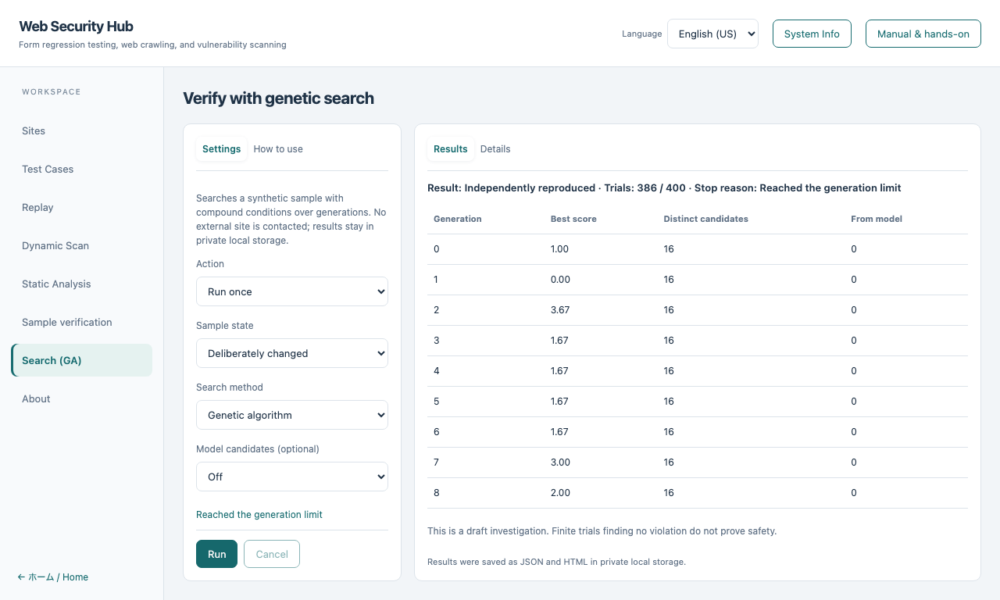

### 1.4 Common parts and operations

| Part | Behavior |
|---|---|
| Tabs | Switch between settings and results. Arrow keys, Home and End move between them. The selected state is conveyed to assistive technology |
| Authorization confirmation | Before assessment, sending or recording, a checkbox confirms authorization for the target. Without it the run button does nothing |
| Run and cancel | While running, [Run] is disabled and [Cancel] is enabled. Cancelling saves results so far and ends |
| Status line | One line under the settings shows waiting, running, completed, cancelled, failed or limit reached, and is announced to screen readers |
| Result tables | Click a row, or focus it and press Enter, to show evidence or details. Reproduced rows are highlighted |
| Training | [Manual & hands-on] shows the material while keeping inputs and results. Esc closes it |
| Language | Switching changes the interface text immediately and keeps entered values |
| Keeping input | Inputs and results are kept when switching tabs or opening training |

### 1.5 Common state expressions

| State | Display |
|---|---|
| Initial | A prompt such as "Choose settings and run" |
| Running | "Running…" with a count of progress where known |
| Completed | A completion message and where results were saved |
| Cancelled | "Cancelled", indicating results are partial |
| Deadline or limit | A message distinct from completion, showing a limit was reached |
| Failed or rejected | A short reason that prompts checking the settings. Input details and internals are not shown |

## 2. S-00 Start screen (desktop edition)

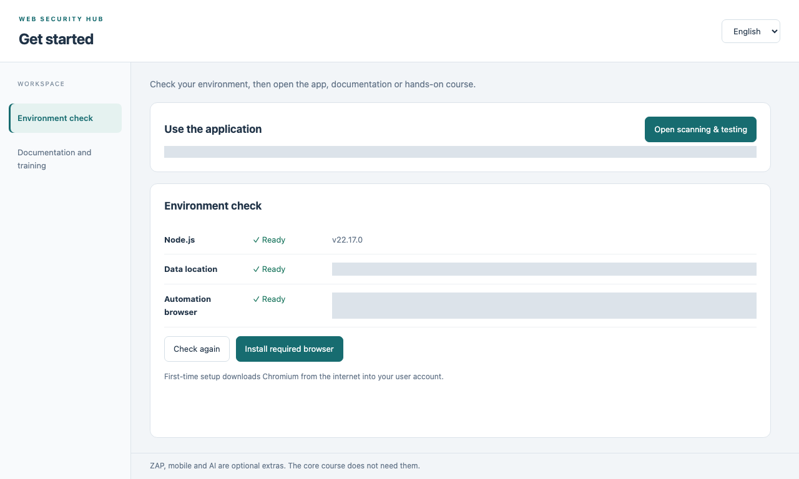

| Area | Item | Behavior |
|---|---|---|
| Environment check | [Re-check] | Checks the storage location and the automation browser |
| | [Install required browser] | Installs the automation browser (Chromium) into the user's area. The first time needs an internet connection. The log is shown in a collapsible |
| | Links into the app | Open assessment and testing, open sample verification |
| Manuals and training | [Start hands-on environment] | Prepares Japanese and English practice-site settings |
| | Links | Illustrated material, the desktop operation guide, the sample site, and static-analysis before and after examples |
| | [Basic] [Changed] [Fixed] | Switch the practice site's state |
| | [Reset sample] | Returns the practice site to its initial state |
| | Confirmation checkbox, [Also reset training settings] | Resets the settings of the two training sites (earlier run results remain) |

## 3. S-01 Site management

Purpose: enter and save the settings of a target; record scenarios.

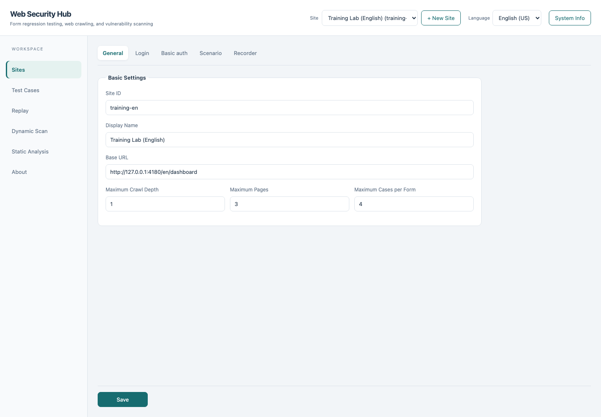

### 3.1 Tabs

General / Login / Basic auth / Scenario / Recording. Every tab shares [Save] and a save status.

### 3.2 Input items

| Tab | Item | Kind | Notes |
|---|---|---|---|
| General | Site ID | Text | Required. Letters, digits, hyphens, underscores |
| | Display name | Text | |
| | Start URL | URL | |
| | Maximum crawl depth | Number | Default 3 |
| | Maximum crawl pages | Number | Default 30 |
| | Maximum cases per form | Number | Default 25 |
| Login | Login URL; username, password and submit selectors | Text | Optional |
| | Login username and password | Text, password | Saved to the secrets file; never shown again |
| Basic auth | Use Basic authentication | Checkbox | |
| | Basic username and password | Text, password | Same |
| Scenario | Scenario JSON | Multi-line | A note says not to enter login details |
| Recording | I have explicit authorization to operate and assess the target | Checkbox | Required to start recording |
| | Record input values other than passwords | Checkbox | Off by default |

### 3.3 Operations

| Button | Behavior |
|---|---|
| Save | Validates and saves the settings and shows the result in the status. Invalid values are not saved |
| Open recording browser | With authorization, opens one visible browser |
| Stop recording and apply to scenario | Reflects recorded actions in the scenario field. Nothing persists until saved |

## 4. S-02 Test case creation

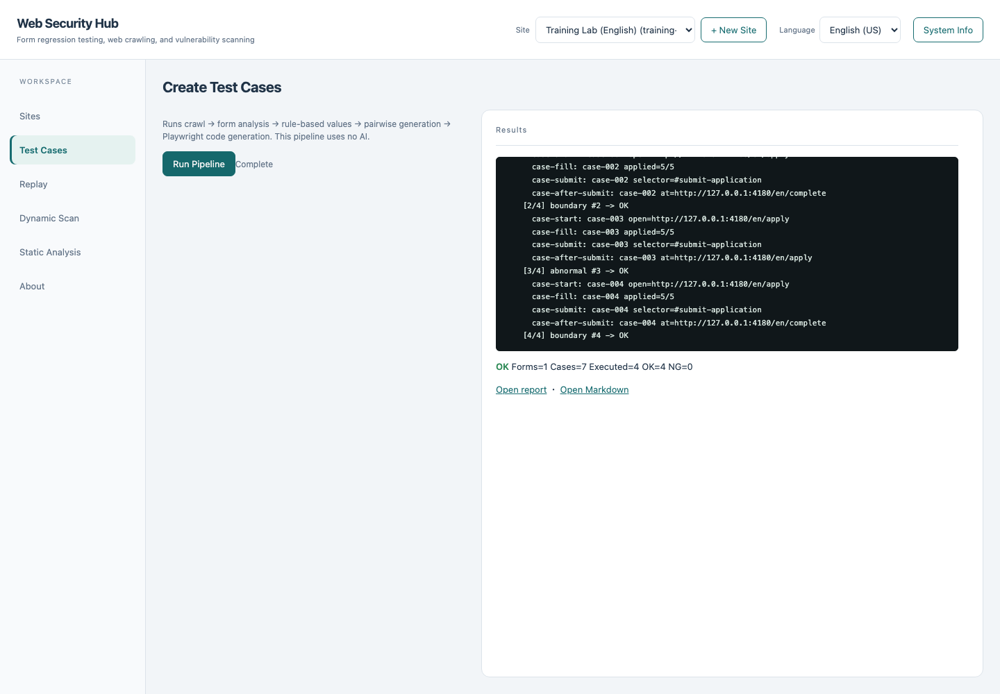

- Description and [Run pipeline] on the left; log and result on the right. If no site is selected, a message asks for one and nothing runs.
- Running shows progress through crawl, form analysis, value generation, pairwise combination and code generation, and on completion shows the session location and the number of forms and cases.
- The description always states that this pipeline does not use AI.

## 5. S-03 Replay

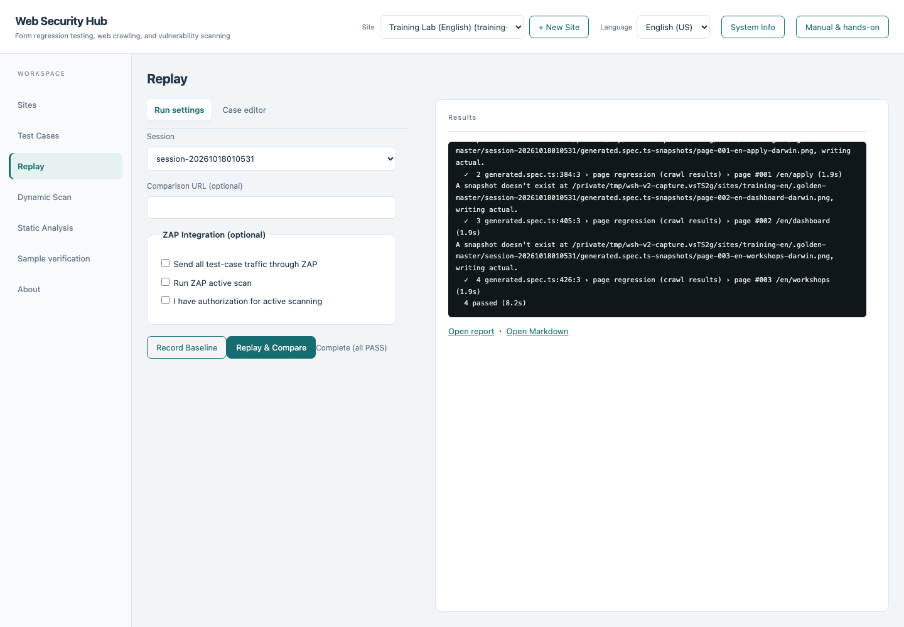

| Tab | Item | Behavior |
|---|---|---|
| Run settings | Session | Choose a saved session |
| | Comparison URL (optional) | Run against another environment |
| | Send all traffic of this run to ZAP | Enable ZAP integration |
| | Also run ZAP active scan / I have authorization for active scan | Active scan runs only when both are on |
| | [Record baseline] [Replay (compare)] | Run; progress and results appear in the log |
| Case editor | [Load] | Loads the session's cases as YAML |
| | Editor, [Save and regenerate] | Saves and regenerates test code. An error is shown if the form is invalid |

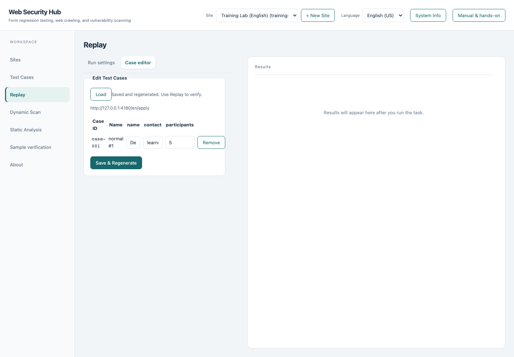

## 6. S-04 Dynamic assessment

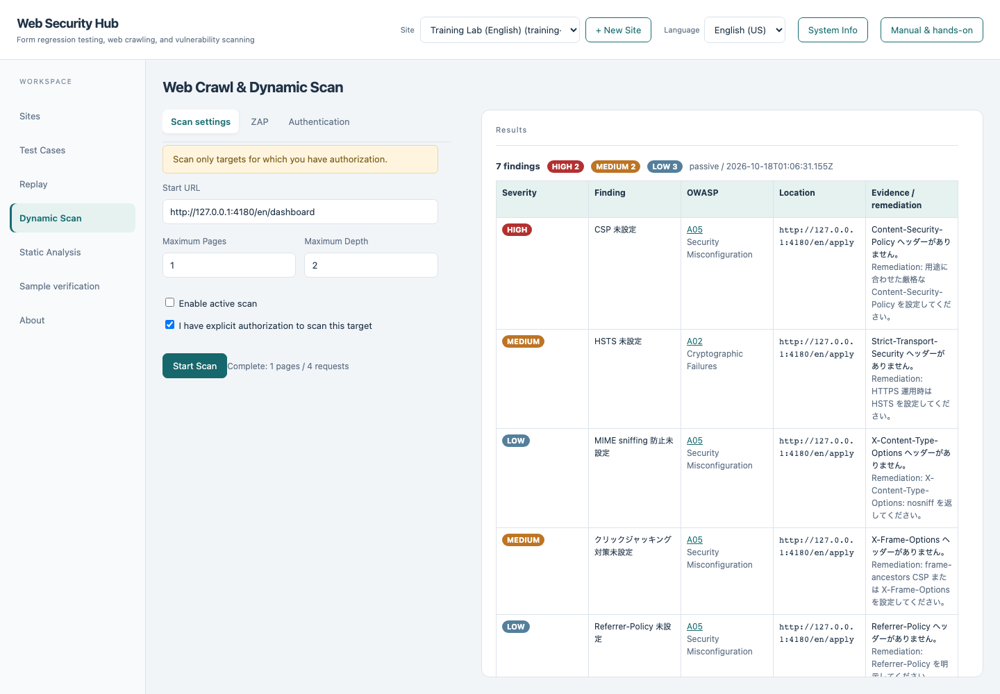

| Tab | Item | Notes |
|---|---|---|
| Scan settings | Start URL | Required |
| | Maximum pages, maximum depth | Defaults 20 and 2 |
| | Enable active scan | Off by default |
| | I have explicit authorization to assess this target | Required. Does not start without it |
| | [Start assessment] | Shows progress and results |
| ZAP | Inspect with ZAP's existing rules | Enable |
| | ZAP API URL, ZAP Proxy URL | |
| | [Check ZAP connection] | Shows whether it is reachable |
| Authentication | Use the selected site's saved scenario | Checkbox |

- Results show a count per severity and a list of findings (severity, title, OWASP category, location, evidence, remediation).
- The top of the screen says to assess authorized targets only.

## 7. S-05 Static analysis

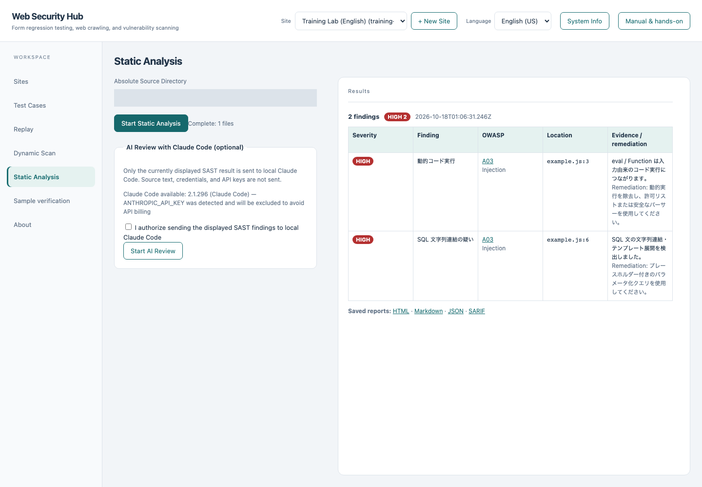

### 7.1 Tabs

Source analysis / Sample / Authorized target / Input values / ZAP environment.

| Tab | Item | Behavior |
|---|---|---|
| Source analysis | Absolute path of the source directory | Input |
| | [Start static analysis] | Analyzes and shows the findings list and links to reports |
| | AI review (optional) | An explanation that only the displayed results are given, with permission, to a local external AI tool; a permission checkbox; [Start AI review]. Shows whether the tool is available |
| Sample | [Run sample check] [Cancel] | Analyzes the bundled sample, checks source against the authorized target and runs trials. A note says the source entered above is not executed |
| Authorized target | Finding and route | Only unique routes among analyzed findings can be chosen |
| | Target origin | Numeric loopback, HTTP, port |
| | I authorize sending a normal control and a candidate to this target | Required |
| | [Verify authorized target] [Cancel] | Runs trials anonymously |
| Input values | Normal-control values, candidate values | JSON objects |
| | Expected JSON fields of the normal control, expected HTTP status | |
| ZAP environment | Also run passive checks with the dedicated ZAP | Checkbox |
| | [Install ZAP + Java (about 330 MB)] [Cancel installation] | An optional additional engine. A note says ordinary verification works without it |

### 7.2 Results

- Analysis result: a count per severity and the findings list (individual identifier, position, severity, OWASP category, route candidate). Selecting a finding shows the source identifier and mapping details.
- Verification result: responses of the normal control and the candidate, the verdict (including under investigation), passive evidence (when enabled) and the report view.

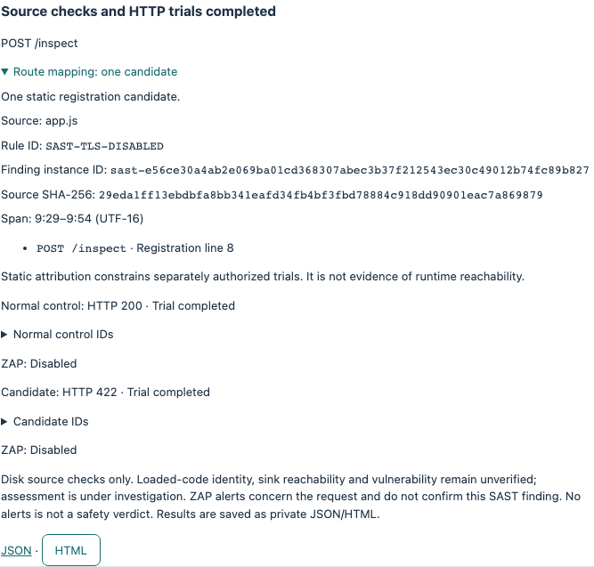

## 8. S-06 Sample verification

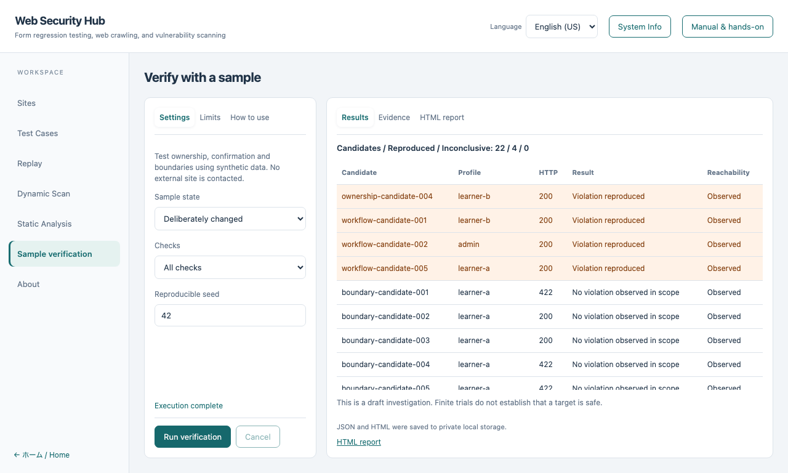

### 8.1 Structure

| Area | Content |
|---|---|
| Settings (left tabs) | Settings / Limits / How to use |
| Results (right tabs) | Results / Evidence / HTML report |

### 8.2 Input items

| Tab | Item | Kind and constraints |
|---|---|---|
| Settings | Sample state | Choice: Baseline, Deliberately changed, Fixed |
| | Checks | Choice: All, Boundary and Unicode, Ownership, Confirmation workflow |
| | Reproducible seed | Integer (0 or more) |
| Limits | Candidates per check | Integer (1–64) |
| | Trials including normal controls | Integer (1–1,000) |
| | Time budget (ms) | Integer (up to 1 hour) |
| How to use | — | Step-by-step explanation |

### 8.3 Display

- Summary: counts of "candidates / reproduced / inconclusive".
- Results table: columns for candidate, profile, HTTP, result and reachability. Reproduced rows are sorted first and highlighted.
- Evidence: selecting a row shows the trial identifiers, authentication profile, reachability and source identifier as JSON. Cookies and passwords are not included.
- HTML report: shows the saved bilingual report inside the screen.
- After a run, a message says it was saved and a notice says this is a draft investigation that does not assert safety.

## 9. S-07 Search (GA)


### 9.1 Structure

| Area | Content |
|---|---|
| Settings (left tabs) | Settings / How to use |
| Results (right tabs) | Results / Details |

### 9.2 Input items

| Item | Kind | Notes |
|---|---|---|
| Action | Choice: Run once, Compare 3 methods | For comparison, state, method and seed are hidden |
| Sample state | Choice: Baseline, Deliberately changed, Fixed | |
| Search method | Choice: Genetic algorithm, Fixed rules only | A model cannot be used with fixed rules |
| Model candidates (optional) | Choice: Off, Mock, Model on this machine | External services are not offered on the screen |
| Endpoint | URL | For "Model on this machine". 127.0.0.1 only |
| Model name | Text | Same. Up to 128 characters |
| Share of model candidates | Integer (0–100, %) | When a model is used |
| Reproducible seed | Integer (0 or more) | For Run once |
| HTTP trial limit | Integer (2–1,000) | |

### 9.3 Display

- Run-once result: a summary (whether independently reproduced, trials used and the limit, stop reason) and a generation table (generation, best score, distinct candidates, from model).
- Selecting a generation row shows all candidates of that generation (operator, parents, values, score) under "Details".
- Comparison result: a table per method × state (valid / total runs, reproduced / valid, trials to first reproduction (median), measured points reached, duplicates, time, tokens). A row reproducing on the fixed sample is highlighted.
- A running comparison shows completed / total. A cancelled comparison is shown as "Cancelled".

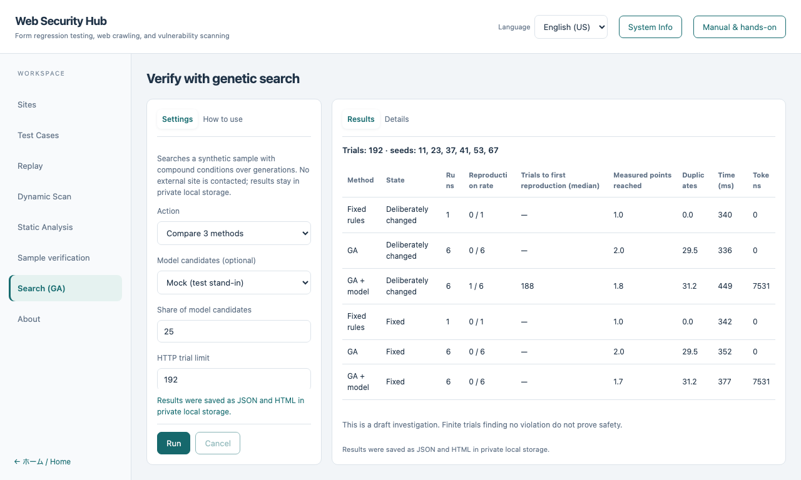

## 10. S-08 VEX

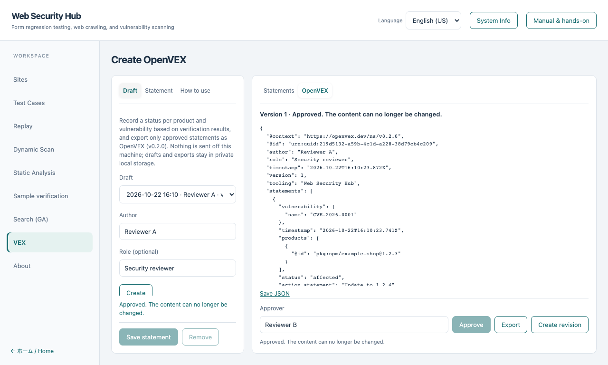

### 10.1 Structure

| Area | Content |
|---|---|
| Settings (left tabs) | Draft / Statement / How to use |
| Results (right tabs) | Statements / OpenVEX |
| Lower right | Approver, [Approve] [Export] [Create revision] |

### 10.2 Input items

| Tab | Item | Kind and constraints |
|---|---|---|
| Draft | Draft | Choose an existing draft |
| | Author, role (optional) | Text (up to 200 characters), [Create] |
| Statement | Vulnerability ID | Required. Letters, digits and some symbols, up to 128 characters |
| | Description (optional) | Up to 2,000 characters |
| | Product ID | Required. A package URL or similar |
| | Product SHA-256 (optional) | 64 hex digits |
| | Verification results used as evidence | Multiple selection showing kind, date, observation (reproduced / not reproduced / inconclusive) and the start of the ID. [Suggest status from evidence] |
| | Status | Under investigation, Affected, Not affected, Fixed |
| | Basis | Evidence, Reviewer's decision. Choosing not affected or fixed sets "Reviewer's decision" automatically |
| | Justification | Shown only for not affected (five defined values) |
| | Action | Shown only for affected |
| | Notes (optional) | Up to 2,000 characters |
| Lower right | Approver | Text. Required before approval |

### 10.3 Display by state

| State | Display |
|---|---|
| No draft selected | Inputs and action buttons are disabled and a prompt is shown |
| In progress | Inputs work. [Approve] is enabled once there is at least one statement |
| Approved | Inputs, save and remove are disabled and "Approved. The content can no longer be changed." is shown. [Export] and [Create revision] are enabled |
| Not affected or fixed chosen | A notice says it is exported as the reviewer's decision |

### 10.4 Display and operations

- Statements table: vulnerability, product, status, basis and number of evidence items. Selecting a row loads it into the form for editing. [Remove] deletes the selected one.
- [Export] shows the OpenVEX JSON in the "OpenVEX" tab and [Save JSON] downloads it.
- If there are no verification results, a note asks to run a verification first.
- Invalid input, or a status evidence cannot establish, is not saved and a failure message is shown.

## 11. S-09 About

Shows the assessment policy (combining scenario and form regression testing with ZAP-integrated DAST) and links to the Japanese and English illustrated manual and hands-on.

## 12. M-01 System information

A dialog opened by [System info] in the header. It shows information about the running environment in a readable form; [Close] returns.

## 13. M-02 Manual and hands-on

- [Manual & hands-on] in the header shows material in a drawer on the right. It opens the material for the screen you are on (VEX, Search, Sample verification, Static analysis and so on) and the basic hands-on otherwise.
- While open, the background cannot be operated; Esc or [Close] closes it. Afterwards, the original inputs and results are kept.
- The material follows the language (Japanese or English).

## 14. Accessibility and input conventions

- Input fields have labels.
- Tabs convey their role and can be switched with the keyboard alone. Rows in result tables can be focused and opened with Enter.
- Status lines are also announced to screen readers.
- A reproduced row is shown by wording as well as highlighting.
- Secrets such as passwords are masked in the field and are not shown again after saving.
- Numeric fields with a range carry minimum and maximum values and out-of-range input is flagged before running.
