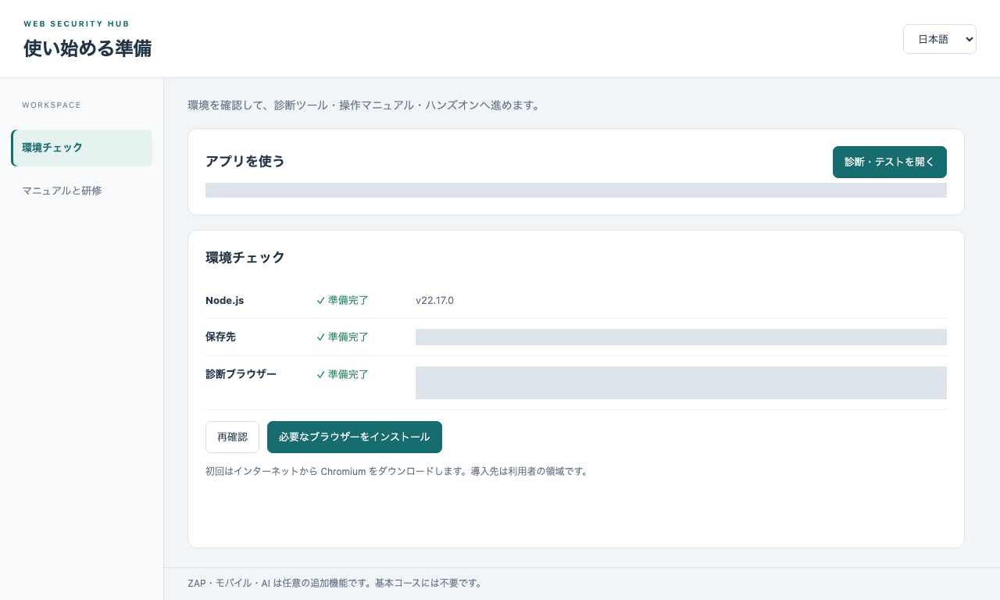
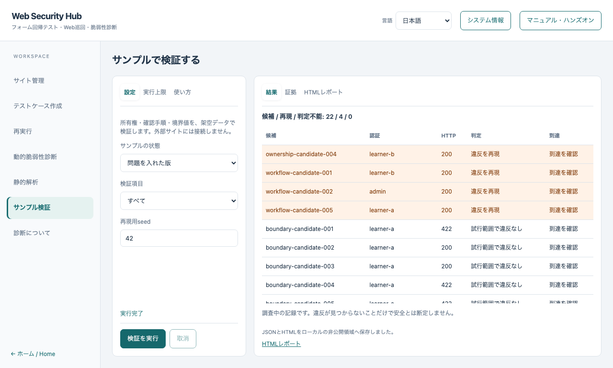
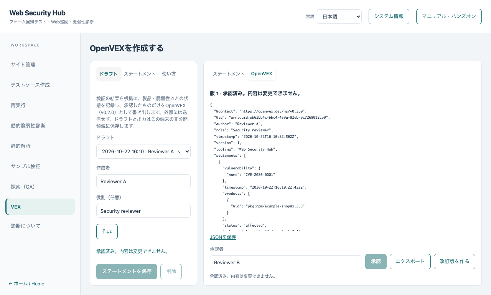

# Web Security Hub 画面設計書

[English version](../SCREEN_DESIGN.md) · [仕様書](SPECIFICATION.md) · [設計書](ARCHITECTURE.md) · [詳細設計書](DETAILED_DESIGN.md)

## 1. 画面の全体構成

### 1.1 画面一覧

| ID | 画面 | 概要 |
|---|---|---|
| S-00 | 開始画面（デスクトップ版） | 環境の確認と導入、練習用サイトの準備、教材への導線 |
| S-01 | サイト管理 | サイト設定の入力・保存、シナリオの記録 |
| S-02 | テストケース作成 | 巡回からテストコード生成までの実行 |
| S-03 | 再実行 | ベースラインの記録、比較実行、ケースの編集 |
| S-04 | 動的脆弱性診断 | 巡回による動的診断と ZAP 連携 |
| S-05 | 静的解析 | ソースの解析、専用サンプル・許可した対象の検証、ZAP 環境 |
| S-06 | サンプル検証 | 専用サンプルの検証と、結果・証拠の確認 |
| S-07 | 探索（GA） | 遺伝的探索と 3 方式の比較 |
| S-08 | VEX | OpenVEX のドラフト作成・承認・書き出し |
| S-09 | 診断について | 診断方針と教材への導線 |
| M-01 | システム情報（ダイアログ） | 実行環境の情報の表示 |
| M-02 | マニュアル・ハンズオン（ドロワー） | 作業中の画面から教材を表示 |

### 1.2 画面遷移

```text
開始画面 S-00 ──▶ アプリ本体（S-01〜S-09）
アプリ本体 ── ヘッダーの［システム情報］──▶ M-01
アプリ本体 ── ヘッダーの［マニュアル・ハンズオン］──▶ M-02（表示中の画面に対応した教材）
左ナビゲーション: サイト管理 / テストケース作成 / 再実行 / 動的脆弱性診断 / 静的解析
                  / サンプル検証 / 探索（GA）/ VEX / 診断について
サンプル検証・探索（GA）の結果 ──▶ VEX（証拠として参照）
```

### 1.3 共通レイアウト

| 領域 | 内容 |
|---|---|
| ヘッダー | アプリ名と説明、版の表示、サイトの選択と［＋ 新規サイト］、言語の選択（日本語・English (US)・Français）、［システム情報］、［マニュアル・ハンズオン］ |
| 左ナビゲーション | 画面の切り替え。選択中の項目を強調表示。下部にホームへの戻りリンク |
| 作業領域 | 左に「設定」、右に「結果」を置く 2 分割。設定側は複数のタブで区切り、結果側は一覧・詳細・レポートに切り替える |
| 固定サイズ | 画面全体は 960×648 以上の固定サイズに収め、ページ全体はスクロールしない。長い設定・結果は、それぞれの領域内でスクロールする |


### 1.4 共通の部品と操作

| 部品 | 動作 |
|---|---|
| タブ | 設定・結果の切り替え。←・→・Home・End で移動できる。選択状態を支援技術に伝える |
| 許可の確認 | 診断・送信・記録の前に、チェックボックスで対象への許可を確認する。未確認なら実行ボタンは動作しない |
| 実行・取消 | 実行中は［実行］を無効にして［取消］を有効にする。取消は、そこまでの結果を保存して終了する |
| 状態表示 | 設定の下に 1 行で、待機・実行中・完了・取消・失敗・上限到達などを表示する。画面の読み上げにも通知する |
| 結果の表 | 行をクリックまたは Enter で、証拠や詳細を表示する。再現した行は強調する |
| 教材 | ［マニュアル・ハンズオン］で、入力と結果を保持したまま教材を表示する。Esc で閉じる |
| 言語 | 切り替えると、画面の文言を即座に切り替える。入力した値は保持する |
| 入力の保持 | タブを移動しても、教材を開いても、入力と結果を保持する |

### 1.5 状態の共通表現

| 状態 | 表示 |
|---|---|
| 初期 | 「設定を選び、実行してください」などの案内 |
| 実行中 | 「実行中…」と、件数の進捗（分かる場合） |
| 完了 | 完了の文言と、保存先の案内 |
| 取消 | 「取消済み」。結果は途中までであることを示す |
| 期限・上限 | 完了とは別の文言で、上限に達したことを示す |
| 失敗・拒否 | 理由を短く示し、設定の確認を促す。入力の詳細や内部の情報は表示しない |

## 2. S-00 開始画面（デスクトップ版）



| 領域 | 項目 | 動作 |
|---|---|---|
| 環境チェック | ［再確認］ | 保存先と診断ブラウザーを確認する |
| | ［必要なブラウザーをインストール］ | 診断ブラウザー（Chromium）を、利用者の領域へ導入する。初回はインターネット接続が必要。ログは折りたたみで表示 |
| | アプリへの導線 | 診断・テストを開く、サンプル検証を開く |
| マニュアルと研修 | ［ハンズオン環境を開始］ | 日英の練習サイトの設定を用意する |
| | リンク | 画像付き教材、アプリ版の操作ガイド、サンプルサイト、静的解析の修正前・修正後の例 |
| | ［基本版］［変更版］［修正版］ | 練習サイトの状態を切り替える |
| | ［サンプルを初期化］ | 練習サイトを初期状態に戻す |
| | 確認チェック、［研修設定も初期化］ | 研修用 2 サイトの設定を初期化する（過去の実行結果は残る） |

## 3. S-01 サイト管理

目的: 診断対象の設定を入力して保存する。シナリオを記録する。


### 3.1 タブ構成

基本設定／ログイン／Basic 認証／シナリオ／操作記録。すべてのタブに共通の［保存］と保存状況の表示がある。

### 3.2 入力項目

| タブ | 項目 | 種別 | 備考 |
|---|---|---|---|
| 基本設定 | サイトID | テキスト | 必須。英数字・ハイフン・アンダースコア |
| | 表示名 | テキスト | |
| | 起点URL | URL | |
| | 巡回の最大深さ | 数値 | 既定 3 |
| | 巡回の最大ページ数 | 数値 | 既定 30 |
| | フォームあたり最大ケース数 | 数値 | 既定 25 |
| ログイン | ログインURL、ユーザー名・パスワード・送信ボタンのセレクター | テキスト | 任意 |
| | ログインユーザー名、ログインパスワード | テキスト・パスワード | 秘密情報ファイルへ保存。画面には再表示しない |
| Basic 認証 | Basic認証を使用する | チェック | |
| | Basicユーザー名、Basicパスワード | テキスト・パスワード | 同上 |
| シナリオ | シナリオ JSON | 複数行 | ログイン情報は入力しない旨の注意を表示 |
| 操作記録 | 対象を操作・診断する明示的な許可を得ています | チェック | 記録の開始に必須 |
| | パスワード以外の入力値を記録する | チェック | 既定はオフ |

### 3.3 操作

| ボタン | 動作 |
|---|---|
| 保存 | 設定を検証して保存し、結果を状態表示に出す。不正な値は保存しない |
| 記録用ブラウザーを開く | 許可がある場合に、可視ブラウザーを 1 つ開く |
| 記録を停止してシナリオへ反映 | 記録した操作をシナリオ欄に反映する。保存するまで永続化しない |

## 4. S-02 テストケース作成


- 左に説明と［パイプラインを実行］、右にログと結果を表示する。サイトが選択されていない場合は、選択を促す文言を表示して実行しない。
- 実行すると、巡回・フォーム解析・値生成・ペアワイズ・コード生成の進捗を順に表示し、完了するとセッションの場所と、フォームとケースの件数を示す。
- 説明に「このパイプラインでは AI を使用しない」旨を常に表示する。

## 5. S-03 再実行


| タブ | 項目 | 動作 |
|---|---|---|
| 実行設定 | セッション | 保存済みセッションの選択 |
| | 比較先URL（任意） | 別の環境に対して実行する |
| | このテストケース実行の全通信を ZAP に送る | ZAP 連携の有効化 |
| | ZAP アクティブ検査も実行する／アクティブ検査の許可を得ています | 両方がオンのときだけ、アクティブ検査を実行 |
| | ［ベースラインを記録］［再実行（比較）］ | 記録・比較の実行。進捗と結果をログに表示 |
| ケース編集 | ［読み込む］ | セッションのケースを YAML として読み込む |
| | 編集欄、［保存して再生成］ | 保存し、テストコードを再生成する。形式が不正な場合はエラーを表示する |


## 6. S-04 動的脆弱性診断


| タブ | 項目 | 備考 |
|---|---|---|
| 診断設定 | 開始URL | 必須 |
| | 最大ページ数、最大深さ | 既定 20・2 |
| | アクティブ検査を有効にする | 既定はオフ |
| | 診断の明示的な許可を得ています | 必須。未確認なら開始しない |
| | ［診断を開始］ | 進捗と結果を表示 |
| ZAP | ZAP の既存ルールで検査する | 有効化 |
| | ZAP API URL、ZAP Proxy URL | |
| | ［ZAP 接続を確認］ | 到達できるかを表示 |
| 認証・シナリオ | 選択中サイトの保存済みシナリオを使用する | チェック |

- 結果は、重要度の件数の集計と、検出の一覧（重要度、題名、OWASP 分類、場所、根拠、修正案）で表示する。
- 画面の上部に「許可済みの対象だけを診断してください」と表示する。

## 7. S-05 静的解析


### 7.1 タブ構成

ソース解析／専用サンプル／許可した対象／入力値／ZAP環境。

| タブ | 項目 | 動作 |
|---|---|---|
| ソース解析 | 解析するソースディレクトリの絶対パス | 入力 |
| | ［静的解析を開始］ | 解析し、検出の一覧とレポートへのリンクを表示 |
| | AI レビュー（任意） | 表示中の結果だけを、許可のうえでローカルの外部 AI ツールに渡す旨の説明、許可のチェック、［AI レビューを開始］。ツールを利用できるかを表示 |
| 専用サンプル | ［専用サンプルで照合を実行］［取消］ | 同梱サンプルを解析し、ソースと許可先を照合して試行する。上のソース入力は実行しない旨を表示 |
| 許可した対象 | 個別検出とルート | 解析した検出のうち、一意なルートだけを選べる |
| | 対象のorigin | 数値 loopback・HTTP・ポート |
| | この対象への正常対照・候補の送信を許可します | 必須 |
| | ［許可した対象を検証］［取消］ | 匿名で試行する |
| 入力値 | 正常対照の値、候補の値 | JSON のオブジェクト |
| | 正常対照で期待するJSONの項目、期待HTTP status | |
| ZAP環境 | 専用ZAPでパッシブ検査も実行 | チェック |
| | ［ZAP＋Javaを導入（約330 MB）］［導入を取消］ | 任意の追加エンジン。未導入でも通常の検証ができる旨を表示 |

### 7.2 結果

- 解析結果: 重要度の件数、検出の一覧（個別の識別子、位置、重要度、OWASP 分類、ルート候補）。検出を選ぶと、ソースの識別子と対応付けの詳細を表示する。
- 検証結果: 正常対照と候補の応答、判定（調査中を含む）、受動証拠（有効な場合）、レポートの表示。


## 8. S-06 サンプル検証



### 8.1 構成

| 領域 | 内容 |
|---|---|
| 設定（左のタブ） | 設定／実行上限／使い方 |
| 結果（右のタブ） | 結果／証拠／HTML レポート |

### 8.2 入力項目

| タブ | 項目 | 種別・制約 |
|---|---|---|
| 設定 | サンプルの状態 | 選択: 正常版・問題を入れた版・修正版 |
| | 検証項目 | 選択: すべて・境界値/Unicode・所有権・確認から完了への遷移 |
| | 再現用seed | 整数（0 以上） |
| 実行上限 | 各項目の候補上限 | 整数（1〜64） |
| | 正常対照を含む試行上限 | 整数（1〜1,000） |
| | 実行時間の上限（ms） | 整数（上限は 1 時間） |
| 使い方 | — | 手順の説明 |

### 8.3 表示

- 結果の概要: 「候補 / 再現 / 判定不能」の件数。
- 結果の表: 候補、認証、HTTP、判定、到達の各列。再現した行を先頭に並べて強調する。
- 証拠: 行を選ぶと、試行の識別子、認証プロファイル、到達の観測、ソースの識別子を JSON で表示する。クッキーやパスワードは含めない。
- HTML レポート: 保存した日英併記のレポートを、画面内に表示する。
- 実行後に、保存した旨と、「調査中の記録であり、安全の断定はしない」旨の注意を表示する。

## 9. S-07 探索（GA）


### 9.1 構成

| 領域 | 内容 |
|---|---|
| 設定（左のタブ） | 設定／使い方 |
| 結果（右のタブ） | 結果／詳細 |

### 9.2 入力項目

| 項目 | 種別 | 備考 |
|---|---|---|
| 実行内容 | 選択: 1回探索・3方式を比較 | 比較のときは状態・方式・seed の入力を隠す |
| サンプルの状態 | 選択: 正常版・問題を入れた版・修正版 | |
| 探索方式 | 選択: 遺伝的アルゴリズム・固定ルールのみ | 固定ルールのときはモデルを使えない |
| モデル候補（任意） | 選択: 使わない・モック・この端末のモデル | 外部サービスは画面に出さない |
| エンドポイント | URL | 「この端末のモデル」のとき。127.0.0.1 のみ |
| モデル名 | テキスト | 同上。128 文字以内 |
| モデル候補の割合 | 整数（0〜100、%） | モデルを使うとき |
| 再現用seed | 整数（0 以上） | 1 回探索のとき |
| HTTP試行の上限 | 整数（2〜1,000） | |

### 9.3 表示

- 1 回探索の結果: 概要（独立再現の有無、試行の使用数と上限、停止理由）と、世代の表（世代、最良スコア、異なる候補の数、モデル由来の数）。
- 世代の行を選ぶと、「詳細」にその世代の全候補（演算、親、値、スコア）を表示する。
- 3 方式の比較の結果: 方式×状態の表（有効/実行回数、再現/有効回数、最初の再現までの試行（中央値）、到達した計測点、重複、時間、token）。修正版で再現した行は強調する。
- 実行中の比較は、完了件数/全件数を表示する。取消した比較は「未完了」と表示する。


## 10. S-08 VEX



### 10.1 構成

| 領域 | 内容 |
|---|---|
| 設定（左のタブ） | ドラフト／ステートメント／使い方 |
| 結果（右のタブ） | ステートメント／OpenVEX |
| 右下の操作 | 承認者、［承認］［エクスポート］［改訂版を作る］ |

### 10.2 入力項目

| タブ | 項目 | 種別・制約 |
|---|---|---|
| ドラフト | ドラフト | 既存のドラフトの選択 |
| | 作成者、役割（任意） | テキスト（200 文字以内）、［作成］ |
| ステートメント | 脆弱性ID | 必須。英数字と一部の記号、128 文字以内 |
| | 説明（任意） | 2,000 文字以内 |
| | 製品ID | 必須。パッケージ URL など |
| | 製品のSHA-256（任意） | 64 桁の 16 進 |
| | 根拠にする検証結果 | 複数選択。種別・日時・観測（再現／再現せず／判定不能）・ID の先頭を表示。［証拠から状態を提案］ |
| | 状態 | 調査中・影響あり・影響なし・修正済み |
| | 根拠 | 証拠・レビュー担当者の判断。影響なし・修正済みを選ぶと、自動で「レビュー担当者の判断」にする |
| | 理由 | 影響なしのときだけ表示（定義済みの 5 種） |
| | 対応方針 | 影響ありのときだけ表示 |
| | 補足（任意） | 2,000 文字以内 |
| 右下 | 承認者 | テキスト。承認の前に必須 |

### 10.3 状態による表示の切り替え

| 状態 | 表示 |
|---|---|
| ドラフト未選択 | 入力と操作ボタンを無効にし、案内を表示 |
| 編集中 | 入力できる。ステートメントが 1 件以上あれば［承認］が有効 |
| 承認済み | 入力・保存・削除を無効にし、「承認済み。内容は変更できません」を表示。［エクスポート］と［改訂版を作る］が有効 |
| 影響なし・修正済みを選択 | 「レビュー担当者の判断として書き出される」旨の注意を表示 |

### 10.4 表示と操作

- ステートメントの表: 脆弱性、製品、状態、根拠、証拠の件数。行を選ぶと、フォームに読み込んで編集できる。［削除］で選択中のものを削除する。
- ［エクスポート］で OpenVEX の JSON を「OpenVEX」タブに表示し、［JSONを保存］でダウンロードする。
- 検証結果がない場合は、先に検証を実行するよう案内する。
- 不正な入力や、証拠から導けない状態は、保存せず、失敗の文言を表示する。

## 11. S-09 診断について

診断の方針（シナリオ・フォーム回帰テストと ZAP 統合の組み合わせ）と、日英の画像付きマニュアル・ハンズオンへのリンクを表示する。

## 12. M-01 システム情報

ヘッダーの［システム情報］で開くダイアログ。実行環境の情報を整形して表示し、［閉じる］で戻る。

## 13. M-02 マニュアル・ハンズオン

- ヘッダーの［マニュアル・ハンズオン］で、右側のドロワーとして教材を表示する。表示中の画面（VEX、探索、サンプル検証、静的解析など）に対応した教材を開き、それ以外は基本のハンズオンを開く。
- 表示中は背景の操作を止め、Esc または［閉じる］で閉じる。閉じたあとは、元の入力と結果が保持されている。
- 言語（日本語・英語）に合わせた教材を表示する。

## 14. アクセシビリティーと入力の規約

- 入力欄にはラベルを付ける。
- タブは役割を伝え、キーボードだけで切り替えられる。結果の表の行は、フォーカスして Enter で開ける。
- 状態表示は、画面の読み上げにも通知する。
- 再現した行は、強調表示に加えて、判定の文言でも示す。
- 秘密情報（パスワードなど）は、入力欄で伏せ、保存後は再表示しない。
- 範囲のある数値は、入力欄に最小値・最大値を持たせ、範囲外は実行前に指摘する。
