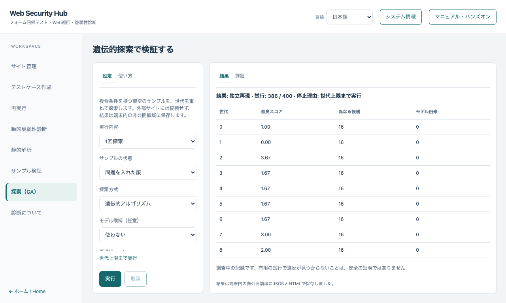
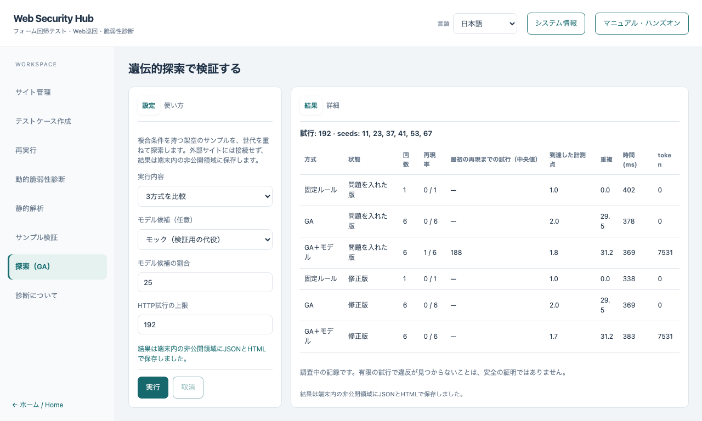

# 遺伝的探索ハンズオン

[English](GENETIC.md) · [サンプル検証](VERIFIER.ja.md) · [基本コース](README.ja.md)

3つの条件が同時にそろったときだけ違反になる架空のサンプルを、世代を重ねて探索します。
外部サイト、実際の認証情報、APIキーは不要です。言語モデルは任意で、初期状態では使いません。

## 1. 画面を開く

左のナビゲーションで **探索（GA）** を選びます。設定と使い方は左、結果と詳細は右に表示されます。
サンプルはこの画面専用で、サイト管理で選んだサイトとは無関係です。

## 2. 問題を入れた版を1回探索する

**1回探索**、**問題を入れた版**、**遺伝的アルゴリズム**、モデル候補 **使わない** を選び、**実行** を押します。
候補を作り、それぞれを独立した正常対照つきで実行し、良い候補を残して交叉・突然変異を行い、これを繰り返します。
違反らしい候補が見つかると、別のセッションで再実行します。この独立した再実行で確認できたものだけが **独立再現** と表示されます。



表の1行が1世代です。最良スコア、異なる候補の数、モデル由来の候補数を表示します。
行をクリック（またはフォーカスしてEnter）すると、その世代の全候補（演算、親、値、スコア）を **詳細** に表示します。
スコアは次の世代の候補を選ぶための順位付けで、違反の判定ではありません。

## 3. 正常版・修正版で再現しないことを確認する

同じ設定で **正常版** と **修正版** を実行します。結果は **再現の対象なし** になります。
探索は、上限への到達、取消、正常対照の失敗、サンプルのソース変更のときも、理由を表示して止まります。
有限の試行で違反が見つからないことは、安全の証明ではありません。

## 4. 3方式を比較する

**3方式を比較** を選びます。同じHTTP試行上限と、事前に固定したseedで、問題を入れた版と修正版に対して次を実行します。

| 方式 | 内容 |
|---|---|
| 固定ルール | 境界値と2の累乗の固定リストを順に試します。結果から学習しません |
| GA | 到達と新規性の観測を使い、選択・交叉・突然変異で候補を改善します |
| GA＋モデル | 同じGAの候補枠の一部をモデルに任せます。モデル候補を「使わない」以外にすると実行されます |



表は順位ではなく測定値として読みます。再現率（独立した再実行で違反を確認できた割合）、最初の再現までの試行、到達した計測点、重複した候補、時間、tokenを表示します。
修正版で再現した場合は誤検知であり、表で強調されます。
既定の192試行では、6つのseedのうちGAが違反を見つけた回数は少ないか0でした。試行上限を増やして再比較してください。結果はseedと上限に依存し、どの方式が常に優れるとは言えません。

## 5. モデル候補（任意）

- **使わない** が初期値です。モデルなしでも探索は完結します。
- **モック** は、最良の候補の近傍を返す決定的な検証用の代役です。言語モデルではなく、性能の主張はしません。
- **この端末のモデル** は、`127.0.0.1` のOpenAI互換サーバー（例：llama.cppのserver）に接続します。送るのは型付きの候補値とスコアだけで、URL・認証情報・ファイル・証拠は送りません。
  応答は厳密なスキーマと許可された値で検査します。不正・途中切れ・拒否・過大・重複の応答は実行せず、限られた回数の再試行後はモデルなしでGAを続けます。
- モデルはスコープ、プロファイル、HTTP試行上限を変更できません。GAの枠を置き換えた候補は、追加の試行を使いません。
- 外部サービスへの送信は、この画面では提供しません。コマンドラインで、明示の許可フラグ、キーの環境変数名、費用上限が必要です。

## 6. 取消と保存

**取消** で実行中の探索や比較を止めます。取り消した比較は未完了と表示します。結果はJSONとHTMLでアプリの非公開データ領域に保存します。保存した結果には架空とはいえ正確な入力が含まれるため、公開しないでください。

## コマンドラインで同じ探索を実行する

```sh
npm run verifier:run -- --genetic-fixture --mode changed
npm run verifier:run -- --genetic-fixture --mode changed --method rules
npm run verifier:run -- --genetic-fixture --mode changed --llm mock
npm run verifier:run -- --genetic-compare --llm mock
```

コマンドラインの利用にはソースの依存関係が必要です。通常のアプリ操作にコマンドは不要です。
