# Web Security Hub 画像付きハンズオン

[English](README.md) · [講師用ガイド](INSTRUCTOR.ja.md) · [機能対応](COVERAGE.md)

目的は、架空の研修申請サイトを使って「対象を登録する → テストを作る → 編集する → 変更を見つける → 診断する」を体験することです。サイト登録先と診断対象を取り違えないよう、Hub は **4173**、サンプルサイトは **4180** を使います。

Node.js 22 以上と npm を準備してください。基本コースには Docker、ZAP は不要です。所要時間の目安は 60〜90 分です（初回ダウンロードを除く）。コマンドはすべてリポジトリのルートで実行します。

画面は左の機能ナビゲーションで切り替えます。サイト管理は「基本設定」「ログイン」「Basic 認証」「シナリオ」「操作記録」、再実行は「実行設定」「ケース編集」のタブに分かれています。動的診断の保存済みシナリオは「認証・シナリオ」タブで選びます。結果とログは右側に表示され、長い内容は各領域内でスクロールします。

## T01 起動と初期化

```sh
npm install
npx playwright install chromium
npm run training:setup
npm run training:start
```

このターミナルは開いたままにし、別のターミナルで次を実行します。

```sh
npm start
```

- Hub: <http://127.0.0.1:4173>
- 日本語サンプル: <http://127.0.0.1:4180/ja/login>
- 英語サンプル: <http://127.0.0.1:4180/en/login>

`training:setup` は `training-ja` / `training-en` のサイト設定と架空の認証情報をローカルに作成します。既存設定は上書きしません。教材の初期設定へ戻すには `npm run training:setup -- --reset` を使います。この操作はこの二つのサイト設定とデモ認証情報を初期化します。既存セッション・ベースラインは残ります。

サンプルのモードを初期化するには、サンプル起動中に次を実行します。

```sh
npm run training:mode -- reset
```

サンプルへの申請は保存されません。モードはメモリ内にあり、再起動すると基本版に戻ります。複数受講者はそれぞれ自分の環境で起動してください。モード変更は同じサーバーを利用する全ブラウザーへ反映されます。

## T02 サンプルサイトを操作する

日本語サンプルを開き、以下でログインします。

| 入力欄 | 値 |
|---|---|
| メールアドレス | `learner@example.test` |
| パスワード | `training-only` |

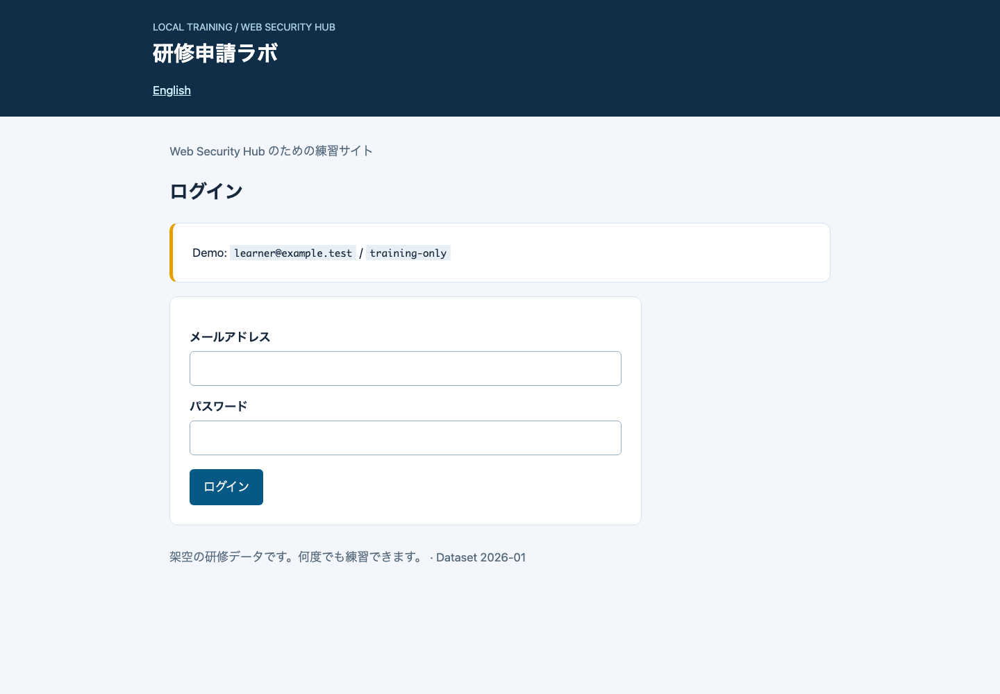

ダッシュボードの「研修に申し込む」を押します。氏名、メール、参加人数を入力し、申請してください。人数は 1〜5 人です。正常なら受付番号 `LAB-0001` の完了画面に進みます。上限を超える入力では送信できないことも確認します。

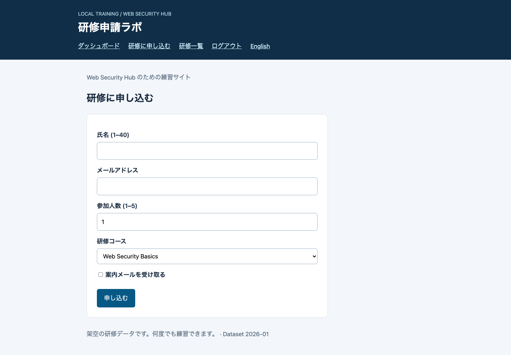

## T03 Hub でサイトを登録・確認する

Hub 右上の言語を「日本語」、上部のサイトを「研修ラボ（日本語） / training-ja」にします。

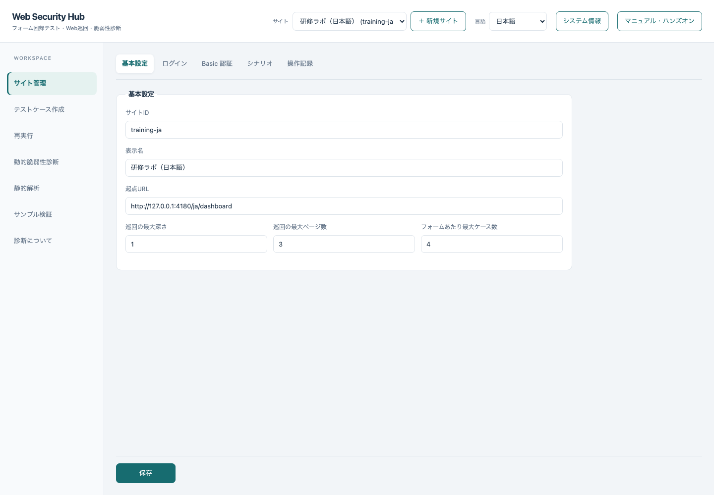

登録操作も練習する場合は「＋ 新規サイト」で次を入力してください。自動作成されたサイトを使う場合は、同じ値が設定されていることを確認して先へ進めます。

| 項目 | 値 |
|---|---|
| サイト ID | `training-ja-practice`（新規登録時） |
| 表示名 | `研修練習` |
| 起点 URL | `http://127.0.0.1:4180/ja/dashboard` |
| 最大深さ／ページ数／ケース数 | `1` / `3` / `4` |
| ログイン URL | `http://127.0.0.1:4180/ja/login` |
| ユーザー名／パスワード／送信セレクタ | `#email` / `#password` / `#sign-in` |
| ログインユーザー名／パスワード | `learner@example.test` / `training-only` |

保存後に認証情報の入力欄が空になるのは正常です。値はサイトの `.env` に保存されています。サンプルのログイン画面と Hub の認証設定欄は別の用途です。

## T04 操作を記録して保存する

「サイト管理」→「操作記録」タブを開き、対象操作の許可にチェックします。「パスワード以外の入力値を記録する」はオフのまま、「記録用ブラウザーを開く」を押します。

別ウィンドウのブラウザーで、ログイン済みのダッシュボードから「研修に申し込む」だけをクリックします。**ここではフォームを入力・送信しません。** Hub に戻り「記録を停止してシナリオへ反映」を押し、JSON を確認して「保存」します。

記録操作が難しい環境では、次の JSON を「保存するシナリオ」に入力することで、同じ申請画面を開始点にできます。自動作成したサイトにはこの JSON が入っています。

```json
{
  "steps": [
    { "action": "goto", "url": "http://127.0.0.1:4180/ja/apply" }
  ]
}
```

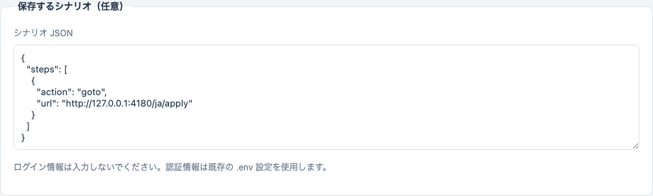

確認：JSON にパスワードがないこと、最終到達画面が申請フォームであること。クリック記録では `click`、直接移動では `goto` が入るため、JSON 全文が画像と一致する必要はありません。


## T05 テストケースを作る

「テストケース作成」→「パイプラインを実行」を押し、完了を待ちます。巡回、フォーム解析、値生成、ケース実行、Playwright コード生成を行います。フォーム送信も実行するので、このサンプルを選択したことを確認してください。

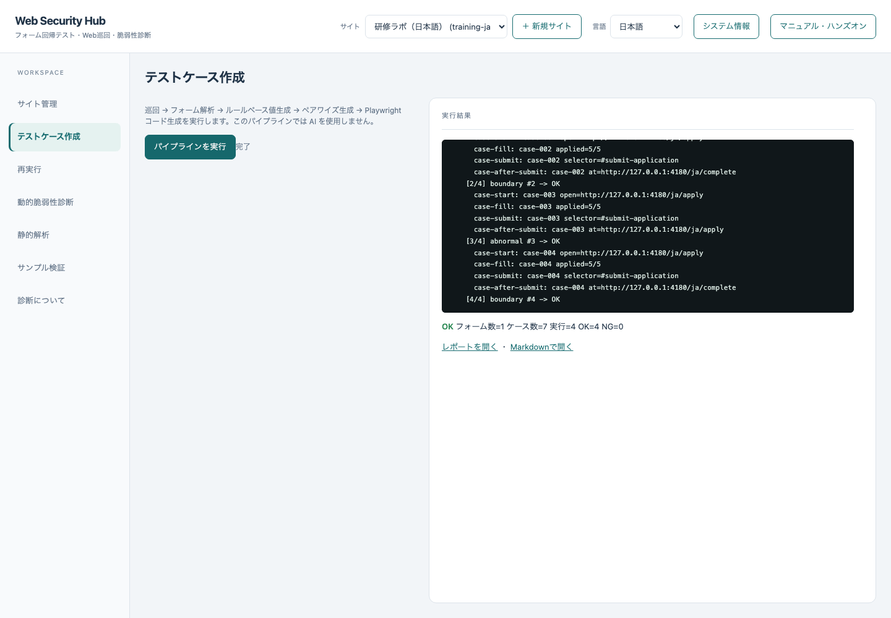

「レポートを開く」で発見したフォームとケースを確認します。人数の最小・最大、空欄、不正なメールなどの候補を探してください。ケース数を 4 に制限しているため、全組合せは含まれません。

生成時の OK は業務仕様全体の正しさの保証ではありません。特に異常値ケースの自動判定は、サーバーが期待どおり拒否したことの厳密なアサーションとは異なります。次の演習では入力を明示して比較します。

## T06 ケースを編集する

「再実行」の「実行設定」で T05 のセッションを選び、「ケース編集」タブの「読み込む」を押します。**最初の 1 行を残して他の行を削除**し、残った行を次の値にします。

| 列 | 値 |
|---|---|
| name | `Demo Learner` |
| contact | `learner@example.test` |
| participants | `5` |
| course（列がある場合） | `web` |
| updates（列がある場合） | `off` |

「保存して再生成」を押します。編集はこのセッションの YAML と生成 spec に反映されます。元の生成レポートは再作成されないため、編集後の結果は再実行レポートを確認します。

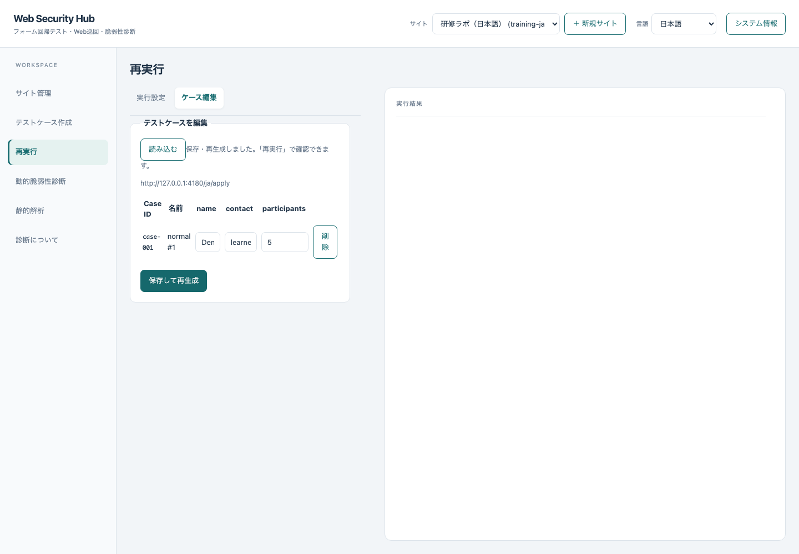

## T07 ベースラインを記録する

サンプルを基本版にします。

```sh
npm run training:mode -- baseline
```

「実行設定」タブに戻り、「比較先 URL」は空欄、ZAP のチェックはすべてオフのまま、「ベースラインを記録」を押します。

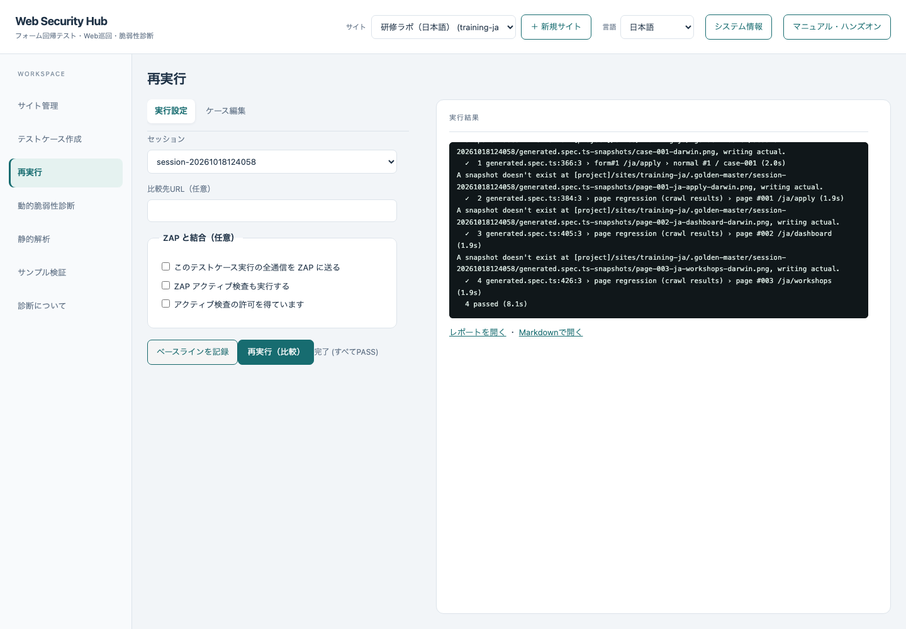

次に「再実行（比較）」を押します。変更していないので、すべて PASS になることを確認します。

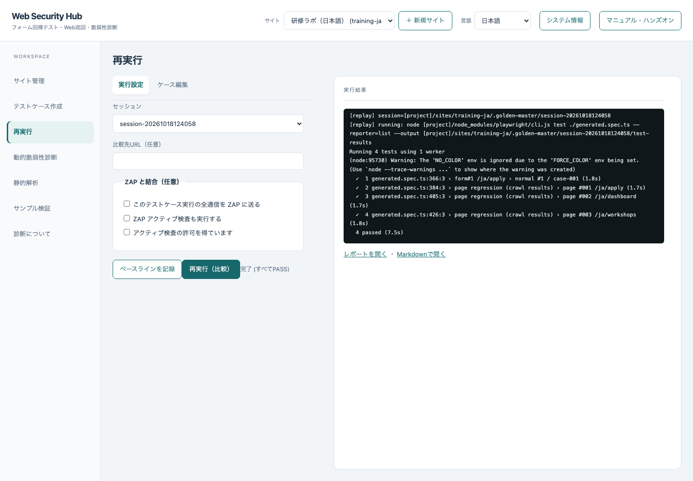

画像比較にはフォームケースに加え、巡回したページも含まれます。テスト件数が編集したケース数より多くなるのは正常です。

## T08 変更を検出し、修正を確認する

```sh
npm run training:mode -- changed
```

同じセッションの「再実行（比較）」を押します。上限が 3 人に変わるため 5 人の申請が完了画面に進まず、フォーム画面にも差分が出ます。「差分あり」を確認し、ログにある expected / actual / diff 画像の保存先を確認します。画像はセッションの `test-results/` 配下など、Playwright がログに示す場所に保存されます。

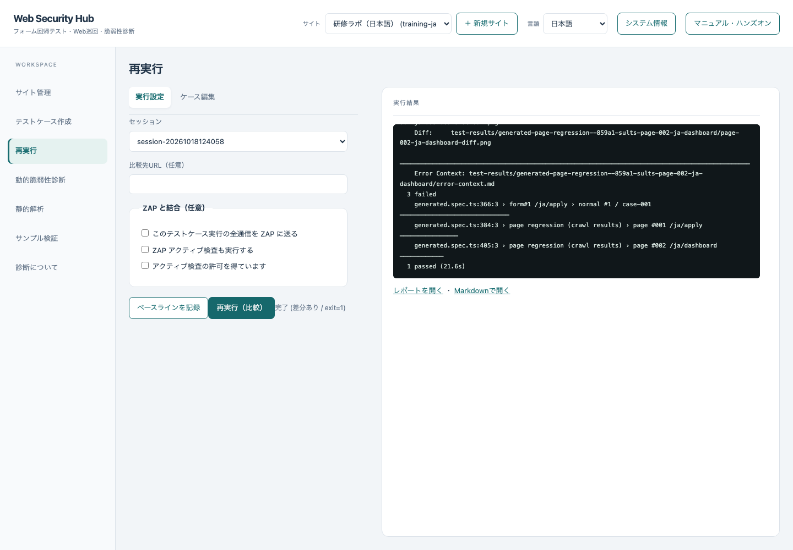

**この時点で「ベースラインを記録」は押しません。** 押すと変更版が新しい正解になります。

```sh
npm run training:mode -- fixed
```

再び「再実行（比較）」を押し、すべて PASS に戻ることを確認します。修正版は元の人数上限と表示を復元します。


## T09 動的診断を実行する

「動的脆弱性診断」で開始 URL がサンプルであることを確認し、「選択中サイトの保存済みシナリオを使用する」「診断の明示的な許可を得ています」にチェックします。最大ページ数は `1`。ZAP とアクティブ検査はオフです。「診断を開始」を押します。

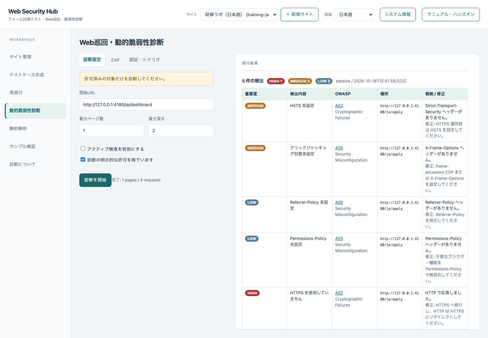

次に `npm run training:mode -- changed` を実行し、同じ診断を繰り返します。変更版で CSP と MIME sniffing 防止ヘッダーの指摘が追加されることを確認します。


`npm run training:mode -- fixed` で修正版に戻し、再診断すると、この二つの指摘が消えます。ローカル HTTP、その他のヘッダーに関する指摘は残ります。この演習は「検出ゼロ」を目標にせず、変更した項目と診断結果の対応を確認します。

## T10 静的解析を実行する

「静的解析」に、リポジトリ内の `training/sast/before` の**絶対パス**を入力し、開始します。macOS / Linux ではルートで `pwd` を実行し、末尾に `/training/sast/before` を付けます。Windows PowerShell では `(Resolve-Path training/sast/before).Path` で確認できます。

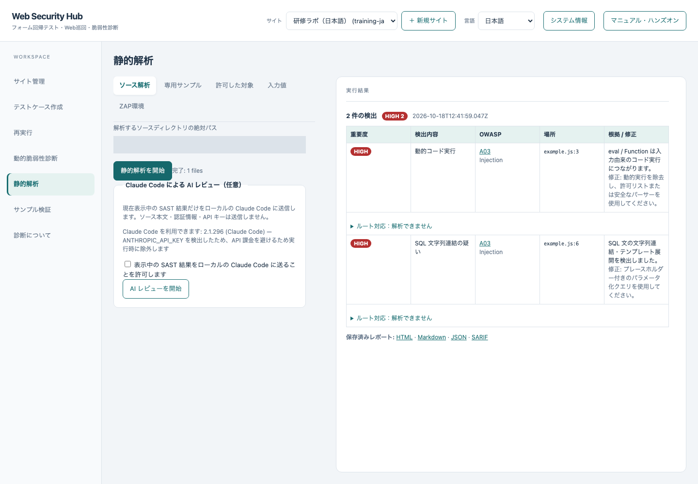

期待するルールは `SAST-DANGEROUS-EVAL` と `SAST-SQL-CONCAT` です。これらのソース例は教材専用で、サンプルサーバーから実行されません。

次に `training/sast/after` の絶対パスへ変えて再実行します。検出が 0 になることを確認します。ただし、このスキャナーで検出されないことがコード全体の安全性を保証するわけではありません。HTML / JSON / Markdown / SARIF のリンクから証跡を確認できます。

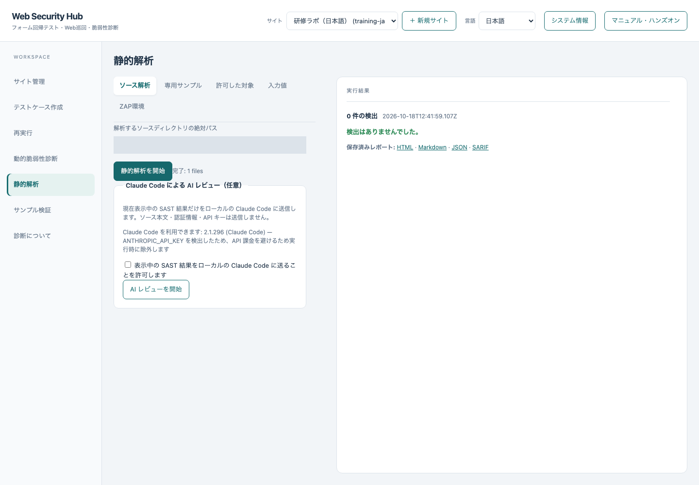

## T11 終了と次の演習

サンプルを `npm run training:mode -- reset` で戻し、Hub とサンプルのターミナルでそれぞれ Ctrl+C を押します。演習記録としてセッション ID、変更した入力値、差分の理由、DAST の追加指摘、SAST のルール ID を残してください。

次は [機能対応表](COVERAGE.md) を見て、ZAP、探索、変数・共有ステップ、ブラウザー切替などの応用へ進めます。

## 困ったとき

| 症状 | 確認と対処 |
|---|---|
| 起動できない／EADDRINUSE | 4173 と 4180 の利用状況を確認。自動撮影・検証は両ポートを使うため手動起動を終了してから実行 |
| ブラウザーがないと言われる | `npx playwright install chromium` を再実行 |
| ログインできない | メール・パスワードと `#email` / `#password` / `#sign-in` を確認。設定を戻すなら `training:setup -- --reset` |
| 記録ブラウザーが開かない | デスクトップ環境が必要。T04 の JSON を使って先へ進む |
| フォームが見つからない | シナリオの最後が `/ja/apply` か確認。送信やログアウトを記録していたら取り除いて保存 |
| 初回比較で差分になる | T07 のベースライン記録が済んでいるか、同じセッションか確認 |
| 修正版でも差分が残る | 編集ケースが保存済みか、サンプルのモードが fixed か確認。OS・ブラウザー・フォント・画面倍率が違う場合は環境を揃える |
| ページ数・件数が画像と異なる | 記録経路、設定、バージョンにより変動。完了状態と期待した入力・差分を確認 |

画面画像は実際のアプリから撮影したものです。撮影条件は [manifest.json](images/manifest.json) を参照してください。Hub の実行ログ・生成ケース名・診断根拠の一部は、英語 UI でも日本語で出力される現状があります。英語版教材には意味と確認方法を併記しています。
