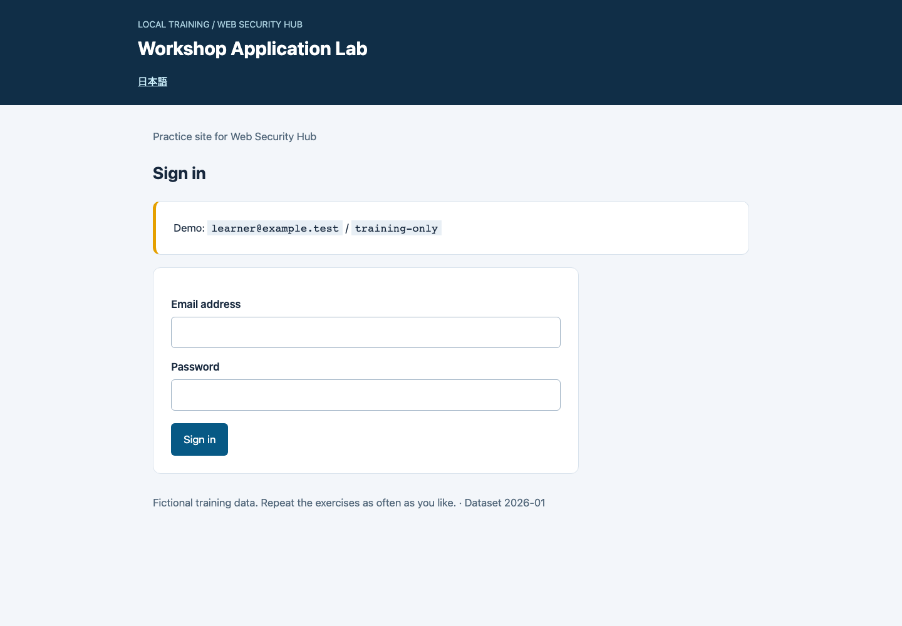
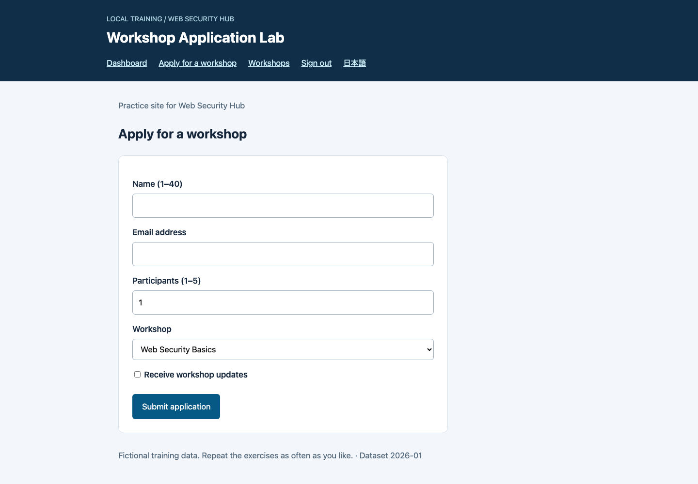
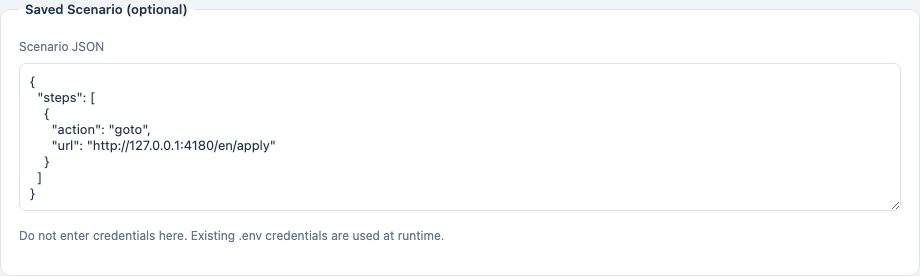
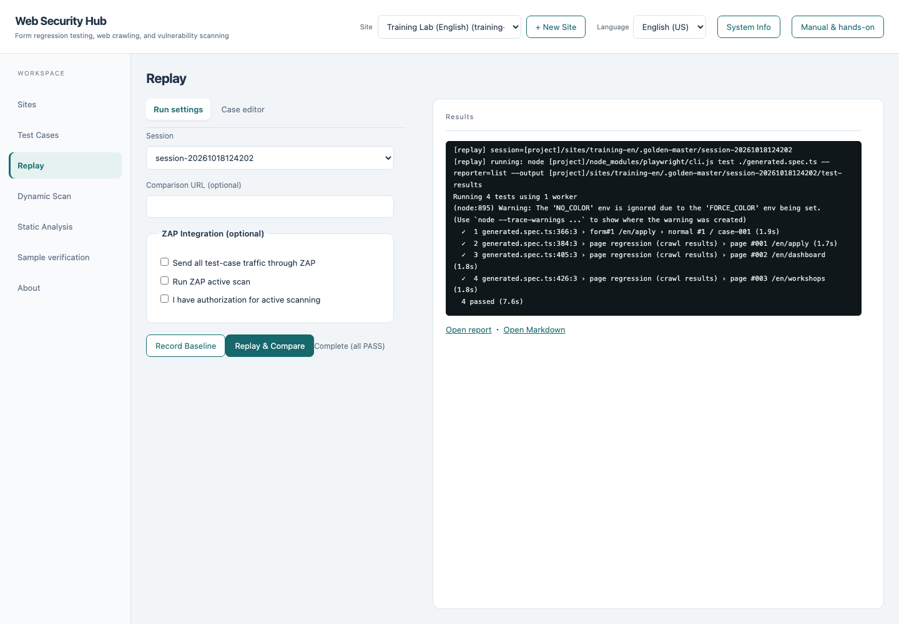
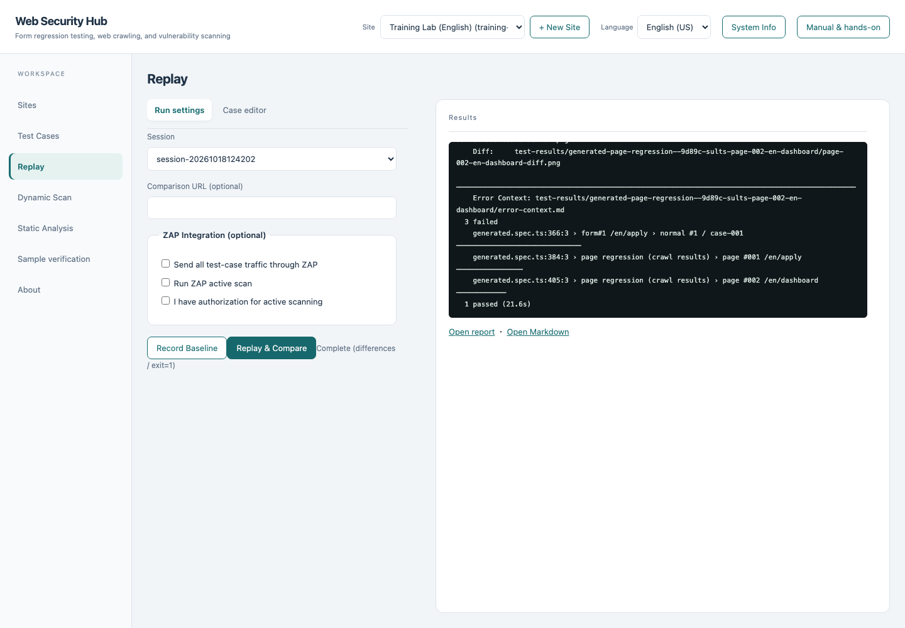
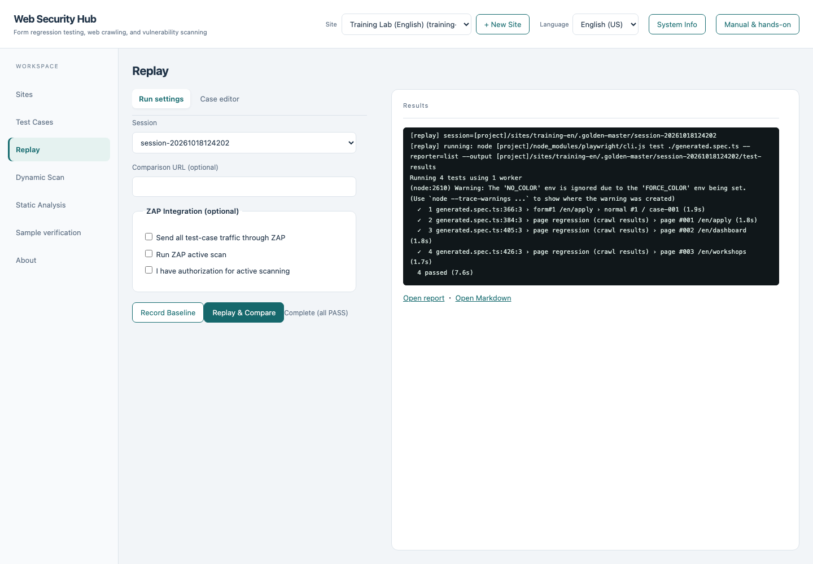
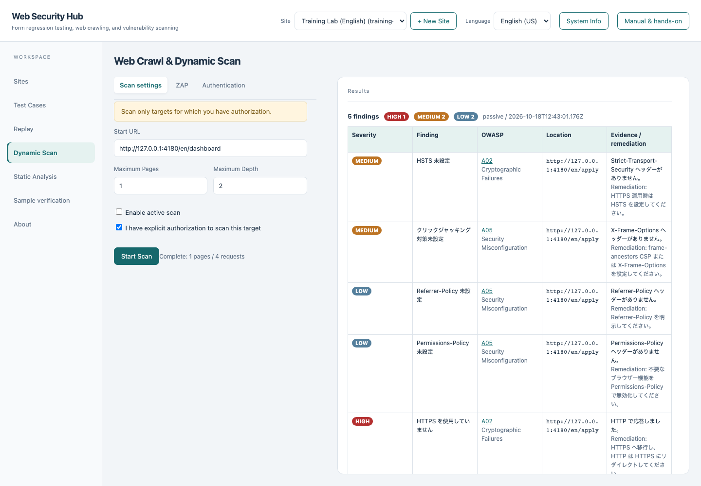
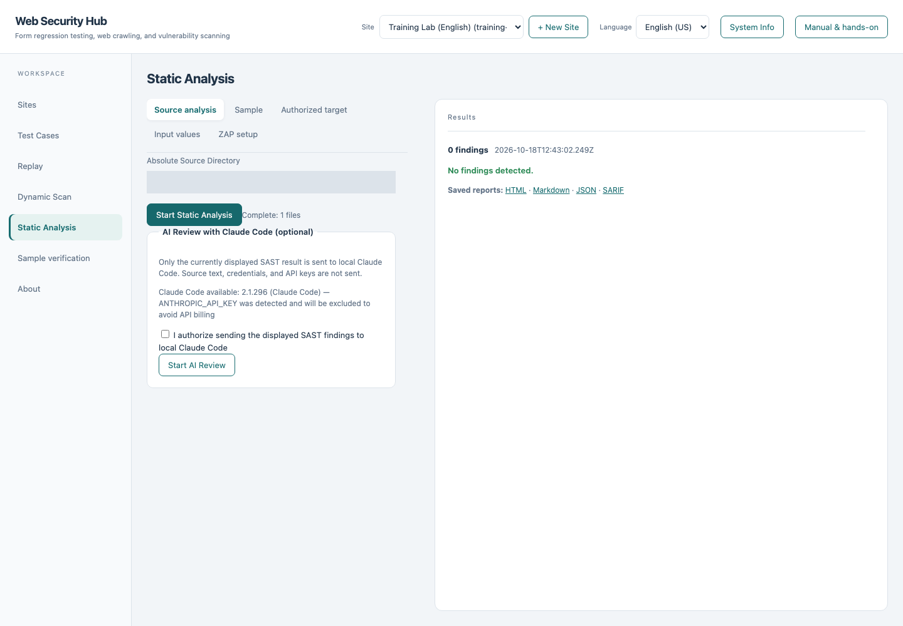

# Web Security Hub illustrated hands-on guide

[日本語](README.ja.md) · [Instructor guide](INSTRUCTOR.md) · [Feature coverage](COVERAGE.md)

Use a fictional workshop application site to practice the full workflow: register a target, generate tests, edit a case, detect a change, and inspect security findings. **Hub runs on port 4173; the target site runs on port 4180.**

Requirements: Node.js 22 or later and npm. The core course does not require Docker, ZAP. Allow approximately 60–90 minutes, excluding initial downloads. Run all commands from the repository root.

Use the left navigation to switch workspaces. Sites has General, Login, Basic auth, Scenario and Recorder tabs. Replay has Run settings and Case editor tabs. Select the saved scenario under Dynamic Scan → Authentication. Results and logs appear on the right; long content scrolls within its own pane.

## T01 Start and reset

```sh
npm install
npx playwright install chromium
npm run training:setup
npm run training:start
```

Keep that terminal open. In another terminal:

```sh
npm start
```

- Hub: <http://127.0.0.1:4173>
- English sample: <http://127.0.0.1:4180/en/login>
- Japanese sample: <http://127.0.0.1:4180/ja/login>

`training:setup` creates two local site configurations, `training-ja` and `training-en`, with fictional credentials. Existing configurations are preserved. To restore the course configuration, use `npm run training:setup -- --reset`. This overwrites only those two configurations and their demo credentials; previous sessions and baselines remain.

With the sample server running, reset its mode:

```sh
npm run training:mode -- reset
```

Applications are never stored. Mode is held in memory and resets to baseline when the sample server restarts. Each learner should run their own environment: changing mode affects every browser connected to that sample server.

## T02 Explore the sample

Open the English sample and sign in:

| Field | Value |
|---|---|
| Email | `learner@example.test` |
| Password | `training-only` |



On the dashboard, select **Apply for a workshop**. Enter a name, email, and participant count, then submit. The valid range is 1–5 participants. A successful submission displays reference `LAB-0001`. Also check that an out-of-range count prevents submission.



## T03 Register or inspect the target in Hub

In Hub, set the language to **English (US)** and select **Training Lab (English) / training-en** in the header.


To practice registration, select **+ New Site** and enter the following. When using the preconfigured site, simply verify the same settings and continue.

| Setting | Value |
|---|---|
| Site ID | `training-en-practice` for a new site |
| Display Name | `Training Practice` |
| Base URL | `http://127.0.0.1:4180/en/dashboard` |
| Maximum depth / pages / cases | `1` / `3` / `4` |
| Login URL | `http://127.0.0.1:4180/en/login` |
| Username / password / submit selector | `#email` / `#password` / `#sign-in` |
| Login username / password | `learner@example.test` / `training-only` |

Credential fields become empty after saving. This is expected: their values are stored in the site's `.env` file. Signing into the sample yourself and configuring Hub's login credentials are separate operations.

## T04 Record and save a scenario

Open **Sites → Recorder** and confirm authorization. Leave **Record non-password input values** unchecked, then select **Open Recording Browser**.

In the separate browser window, start from the authenticated dashboard and click **Apply for a workshop**. **Do not fill or submit the application during this recording.** Return to Hub, select **Stop Recording and Copy to Scenario**, review the JSON, and select **Save**.

If a visible browser cannot be opened in your environment, enter this JSON in **Saved Scenario** instead. It reaches the same application form and is already provided by `training:setup`.

```json
{
  "steps": [
    { "action": "goto", "url": "http://127.0.0.1:4180/en/apply" }
  ]
}
```



Check that no password appears in the JSON and that the final destination is the application form. Recording a click produces `click`; direct navigation produces `goto`. The complete JSON need not match the screenshot.


## T05 Generate tests

Open **Test Cases**, select **Run Pipeline**, and wait for completion. The pipeline crawls pages, extracts forms, generates values, executes cases, and generates Playwright code. It submits forms, so check that your training target is selected.


Select **Open report** and inspect the discovered form and cases. Look for empty values, invalid email addresses, and minimum/maximum participant values. A limit of four cases does not cover every combination.

Generation's OK status does not establish that all business requirements are satisfied. In particular, abnormal-case handling is not a strict assertion that the server rejected the input as intended. The next exercise uses explicit input and visual comparison.

## T06 Edit a case

In **Replay**, select the session created in T05 and select **Load** under **Edit Test Cases**. **Keep the first row and remove all remaining rows.** Change that row to:

| Column | Value |
|---|---|
| name | `Demo Learner` |
| contact | `learner@example.test` |
| participants | `5` |
| course, if present | `web` |
| updates, if present | `off` |

Select **Save & Regenerate**. This updates the session's YAML and generated spec. The original generation report is not rebuilt; use the replay report for subsequent results.


## T07 Record the baseline

Set the sample to its baseline version:

```sh
npm run training:mode -- baseline
```

Leave **Comparison URL** empty and all ZAP options unchecked. Select **Record Baseline**.


Next, select **Replay & Compare**. All tests should pass because the site has not changed.



Replay includes crawled-page screenshots as well as the edited form case. The total test count can therefore exceed the number of cases in the table.

## T08 Detect a change and verify the fix

```sh
npm run training:mode -- changed
```

Select **Replay & Compare** on the same session. The maximum count is now three, so an application for five participants no longer reaches the completion screen. The form itself also changes. Confirm that differences are reported. Inspect the expected, actual and diff image paths in the log; Playwright stores them under the location it reports, such as the session's `test-results/` directory.



**Do not select Record Baseline here.** That would accept the changed version as the new reference.

```sh
npm run training:mode -- fixed
```

Run **Replay & Compare** again. All tests should pass. The fixed version restores the original participant limit and appearance.



## T09 Run a dynamic scan

Open **Dynamic Scan** and verify the target URL points to the sample. Check **Use the saved scenario for the selected site** and the authorization checkbox. Set maximum pages to `1`. Leave ZAP and active scanning disabled, then select **Start Scan**.



Run `npm run training:mode -- changed` and repeat the same scan. Confirm that missing CSP and MIME-sniffing protection findings appear.


Restore `fixed` mode and scan again: those two findings should disappear. Local HTTP and other header findings remain. The goal is to connect deliberate changes with the corresponding findings, rather than to reach zero findings.

## T10 Run static analysis

In **Static Analysis**, enter the **absolute path** to `training/sast/before` and start the scan. On macOS/Linux, run `pwd` from the repository root and append `/training/sast/before`. On Windows PowerShell, use `(Resolve-Path training/sast/before).Path`.


Expected rules: `SAST-DANGEROUS-EVAL` (dynamic code execution) and `SAST-SQL-CONCAT` (SQL string concatenation). These are inert teaching fixtures; the sample server never executes them.

Change the directory to the absolute path of `training/sast/after` and scan again. Expect zero findings from this scanner. This does not prove that an entire application is secure. Open the HTML, JSON, Markdown or SARIF report links to inspect saved evidence.



## T11 Finish

Restore the sample with `npm run training:mode -- reset`, then press Ctrl+C in both server terminals. Record your session ID, edited values, reason for visual differences, additional DAST findings and SAST rule IDs.

Use the [coverage table](COVERAGE.md) to choose subsequent exercises involving ZAP, exploration, variables, shared steps or browser configuration.

## Troubleshooting

| Symptom | Check or recovery |
|---|---|
| EADDRINUSE / server will not start | Check ports 4173 and 4180. Stop manually started servers before running capture or verification automation |
| Browser executable missing | Run `npx playwright install chromium` |
| Sign-in fails | Verify demo credentials and the three selectors. Restore with `training:setup -- --reset` if needed |
| Recording browser will not open | Requires a desktop session. Use the T04 JSON fallback |
| No form discovered | End the scenario at `/en/apply`; remove submission/logout steps and save |
| First comparison reports differences | Record the baseline first; select the same session |
| Fixed version still differs | Check saved edits and fixed mode; keep OS, browser, fonts and display scaling consistent |
| Counts differ from the screenshot | Counts vary with recorded route, settings and version; check completion and expected inputs/results |

Images are real application captures. See [manifest.json](images/manifest.json) for capture conditions. Some engine logs, generated case names and finding descriptions remain in Japanese even in English UI. Relevant meanings and expected rule IDs are explained above; a complete translation of engine output is separate work.
