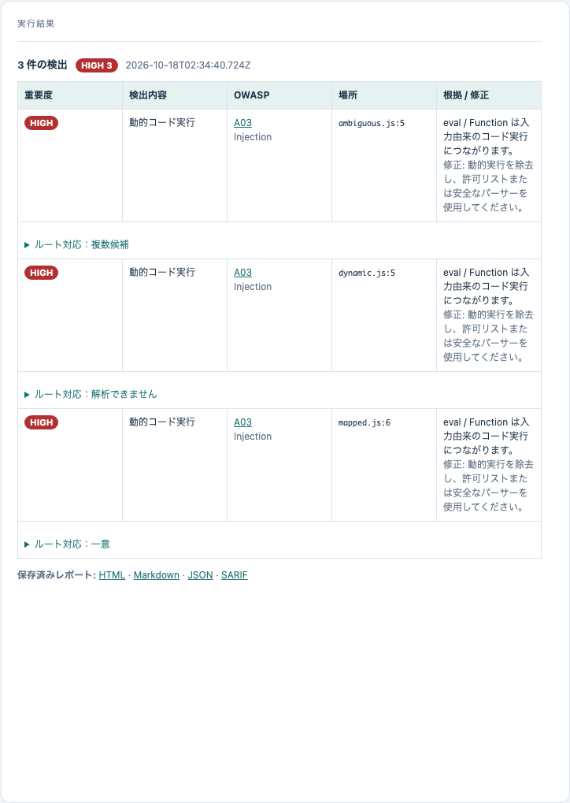
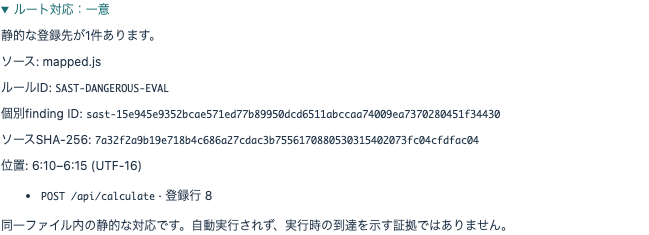

# SASTの個別指摘とルート対応を確認する

[English](SAST-MAPPING.md) · [基本ハンズオン](README.ja.md)

これは3.0.0に向けた開発ブランチの機能です。公開済み2.0.0インストーラーには含まれません。
ソース版で `npm install`、`npm start` を実行して利用します。

## 1. 教材を静的解析する

アプリで **静的解析** を開き、ソースディレクトリーに、この作業コピーの `training/sast/routes` の絶対パスを指定して解析します。
教材は読み取るだけです。ファイルをNodeで起動したり、公開サーバーへ配置したりしないでください。

3件の `SAST-DANGEROUS-EVAL` が表示されます。ルールIDは共通ですが、各指摘の個別finding IDは異なります。
「ルート対応」を開くと、ソースのSHA-256、行・列、静的な候補を確認できます。

## 2. 一意・複数候補・解析不能を比較する

| ファイル | 表示 | 意味 |
|---|---|---|
| `mapped.js` | 一意 | ローカル補助関数から `POST /api/calculate` の登録へ対応する |
| `ambiguous.js` | 複数候補 | 同じ関数が `POST /first` と `POST /second` から参照される |
| `dynamic.js` | 解析できません | 環境変数のルート名を推測しない |

「一意」は同じファイル内の静的な登録先が1件という意味です。実行時の到達、脆弱性の再現、診断許可を意味しません。この機能からHTTPリクエストは実行されません。

## 3. 個別指摘をレポートで追跡する

JSON・HTML・Markdown・SARIFの各レポートへ個別ID・ソースhash・対応情報を保存します。SARIFの `ruleId` は従来どおりで、個別IDは `partialFingerprints` へ追加されます。
ファイルの内容・相対パス・指摘位置が同じなら個別IDは同じです。ソースを変更するとIDが変わるため、古い結果を新しいソースの証拠として扱わないでください。
行・列は1始まり、列とoffsetはUTF-16、範囲の末尾は含みません。

## 対応範囲と未完成の部分

`.js`・`.cjs`・`.mjs`の、トップレベルのExpress生成、文字列のroute/mount、同一ファイル内のハンドラー・middleware・直接呼び出す補助関数を解析します。パラメーターを含むパスは候補のテンプレートとして表示します。
別ファイルからのrouter/handler、factory、動的・条件付き・computed・chainの登録、解析上限などでは対応を確定しません。TypeScriptや他言語の既存SAST指摘も表示を継続しますが、ルート解析は未対応です。

SASTから許可済みの実行scopeへの接続、ZAPの試行別証拠との統合、3.0.0の配布確認は同じフェーズの残作業です。
