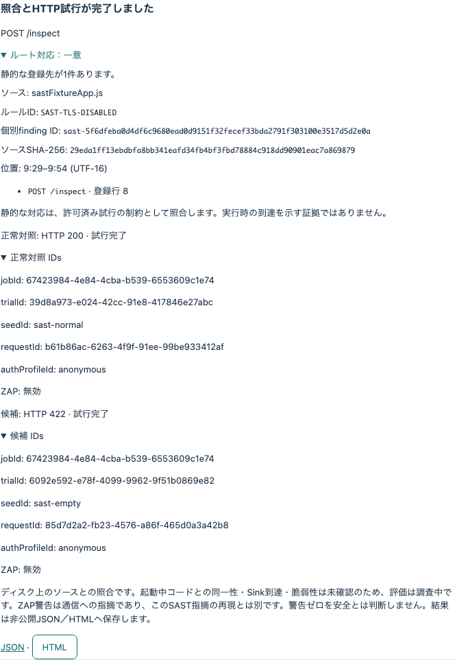
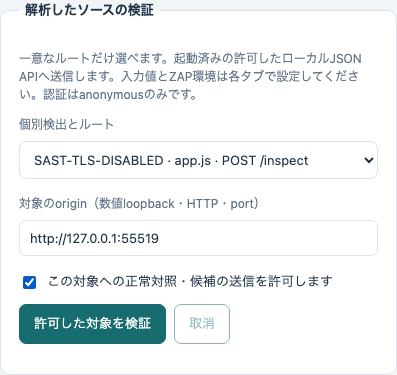
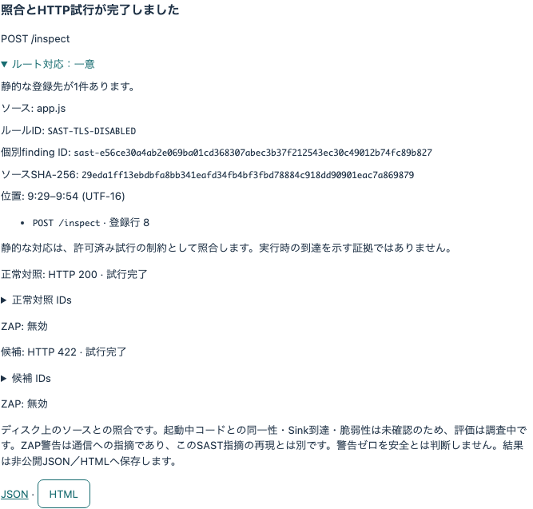
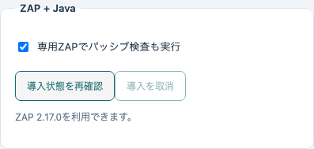
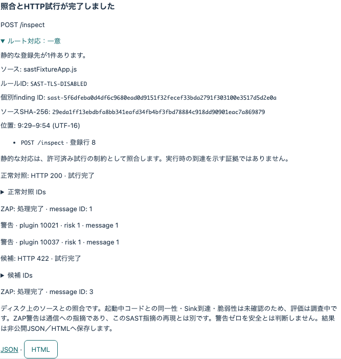

# SAST個別検出・ローカル検証・ZAP証拠

[English](SAST-MAPPING.md) · [基本ハンズオン](README.ja.md)

Web Security Hub 3.0.0で利用できます。「ソース解析」の操作欄は、ソース解析・専用サンプル・許可した対象・入力値・ZAP環境の5タブに分かれています。実行中の画面からヘルプを開け、入力と結果を保持します。

## 1. 個別検出を比較する

ソースタブで、このリポジトリの `training/sast/routes` の絶対パスを解析します。3ファイルは実行しない教材です。Nodeで起動したり公開したりしないでください。静的解析はHTTPを送信しません。


| ファイル | 対応付け | 意味 |
|---|---|---|
| mapped.js | 一意候補 | ローカルhelperをPOST /api/calculateへ対応付け |
| ambiguous.js | 曖昧 | 共有コードがPOST /firstとPOST /secondに登録 |
| dynamic.js | 対応不可 | 環境依存の経路を推測しない |

「ルート対応」を展開します。従来のrule IDを保ち、ファイルのbytes・相対パス・検出位置から個別IDを生成します。編集するとIDも変わります。SHA-256、1始まりの行/列、UTF-16 offsetで解析時点を識別します。終端はexclusiveです。JSON/HTML/Markdown/SARIFにも記録し、SARIFはpartial fingerprintへ個別IDを追加します。


一意な静的候補は、実行許可や到達の証明ではありません。対応範囲はJavaScript（.js/.cjs/.mjs）の同一ファイル内のExpress登録・literal mount・local middleware/handler・直接呼出helperです。import先、factory、条件/計算/chain登録、解析上限では一意と断定しません。他言語の指摘は残しますがルート対応は対象外です。

## 2. 専用サンプルを実行する

サンプルタブから実行します。パスやターミナルは不要です。同梱した信頼済みアプリだけを一時loopback portで起動します。入力したソースをプログラムとしてロードしません。取消で所有する実行を停止し、元の入力と静的結果を保持します。



期待結果は正常対照 **HTTP 200**、候補 **422**、評価は両方 **調査中** です。未使用の `rejectUnauthorized: false` オブジェクトをSASTが検出しますが、この値をTLS接続へ適用していません。ソース照合の演習であり、HTTP結果からTLS脆弱性を確定しません。

送信前と応答後にソースを上限付きで再読取し、rule/位置/digest/個別ID/routeを別途許可したscopeと照合します。受動解析の待機後にも再確認します。変更・読取不能なら証拠を無効にし、追加送信を止めます。起動中プロセスが同じbytesをロードしたことや、指摘箇所の実行は証明しません。

## 3. 許可したローカルJSON APIを検証する

自分のテスト用アプリを別途起動します。ソースを解析し、対象タブで対応する指摘を選びます。一意な、未エンコードASCII literalのGET/POSTだけ実行できます。parameter templateや曖昧な経路は実行しません。originは `http://127.0.0.1:4300` のような数値loopback HTTP・明示した非既定portに限定します。外部host、HTTPS、任意の認証profileは対象外です。

入力値タブで正常対照・候補のJSON object、正常時の2xx status、期待する正常JSONの項目を1つ以上指定します。GETはscalar値をqueryへ、POSTはJSONへ変換します。同梱例では正常 `{"label":"normal"}`、候補 `{"label":""}`、期待JSON `{"accepted":true}`、status 200です。自分のAPIに合わせて設定してください。



対象への送信を明示許可して実行します。ソース選択・指摘・originを変えると許可は解除されます。正常対照を先に実行し、不一致なら候補を送りません。anonymous profileで保存Cookie・自動redirect・retryは使いません。この匿名HTTP経路は受信中の応答を64 KiBで打ち切ります。ソースは1ファイル1 MiBまで、静的解析の探索にも上限があります。



## 4. 必要に応じZAPを導入する

ZAPタブから任意環境を導入します。公式ZAP/Temurin releaseから約330 MBをdownloadし、固定size/SHA-256を確認して展開します。ZAP 2.17.0とTemurin JRE 17.0.20.1+1はアプリ本体とは別の非公開アプリデータに置き、Java heapは512 MiBです。初回導入はインターネットが必要ですが、導入後のローカル検証はオフラインでも利用できます。取消時は途中の展開を除去します。「導入を確認」はreceipt/fileを再検査して修復へ進めます。配布元のlicense/noticeを保持します。



checkboxを有効にし、サンプルまたは許可した対象を実行します。毎回専用process・private home・新しいsessionを所有し、共有ZAPを採用・初期化しません。受動解析だけでspider/active scanは行いません。queue待機は30秒までとし、取消・上限・取得不能・未完了では証拠を採用しません。APIは認証付きloopbackだけです。通常終了と親終了の監視処理が所有process/sessionを回収します。



各試行を展開し、job/trial/seed/request/profileの5ID、ZAP session/message ID、redacted alert fingerprint/plugin ID/rankを確認します。5IDとmethod/正確なURLが1つのproxy messageに一致する必要があります。同URLでも正常側の警告を候補へ流用せず、重複警告をまとめます。生のrequest/response body、Cookie、API key、絶対ソースrootはreportへ含めません。サンプルの受動header警告は未使用TLS flagと別の証拠です。**受動警告はSAST指摘の確定ではなく、警告0件も安全の証明ではありません。** 無効・未完了も明示します。

## 5. 結果を保存・参照する

API操作が結果を返すと、アプリデータの `artifacts/private/source-verifier/<report-id>/` へprivate JSONとescape済み・scriptなしの日英HTMLを保存します。実行結果からJSON downloadとHTMLの埋込表示を使えます。API参照は現在のアプリsessionの所有者に限定し、ディスクのreportは再起動後も残します。必要なprivate fileは自分で保管してください。静的解析reportとは別です。

試行の入力payload値はsource reportへ保存しません。再現にはソースsnapshotと、正確な入力を含むprivate source-plan JSONを保管してください。認証情報・local plan・private reportをcommitしないでください。runtime計測と独立した業務oracleがないため、source検証の評価は常に **調査中** です。

ソース版のコマンド：

```sh
npm run verifier:run -- --sast-sample
npm run verifier:run -- --zap-install
npm run verifier:run -- --zap-status
npm run verifier:run -- --sast-sample --zap
npm run verifier:run -- --source-plan /absolute/private/plan.json
```

source planには `sourceDir`、最新の `finding` metadata（ruleId/findingInstanceId/sourceDigest/relativePath/sourceSpan/routeMapping）、`origin`、`normalValues`、`candidateValues`、`expectedJson`、`expectedStatus`、`authorized: true`、`useZap` を指定します。GUIと同じstrict契約とscope確認を使い、campaign optionと混在できません。CLIはJSONとprivate保存先を表示し、取消はexit 130です。既存baseline/changed/fixed campaignも利用できます。

任意engine：[ZAP](https://www.zaproxy.org/download/)（Apache-2.0）、[Temurin](https://adoptium.net/temurin/)（GPLv2 with Classpath Exception）。デスクトップ配布はソース用のAppium/WebdriverIO追加自動化依存を含めません。その追加依存chainにはextract-zipの既知advisoryが残ります。[セキュリティ情報](https://github.com/masahiroid/web-security-hub/blob/main/SECURITY.md)を参照してください。
