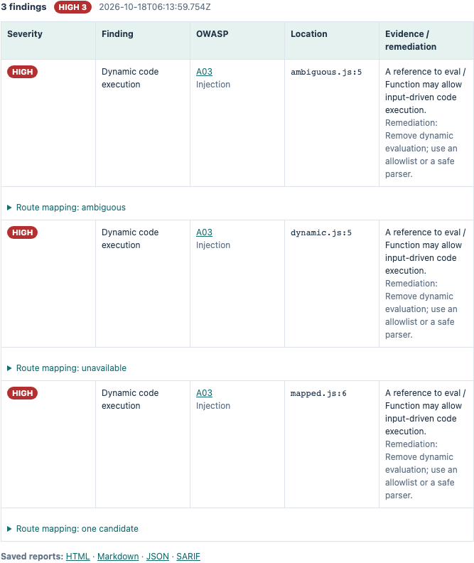
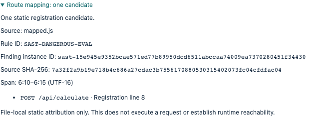
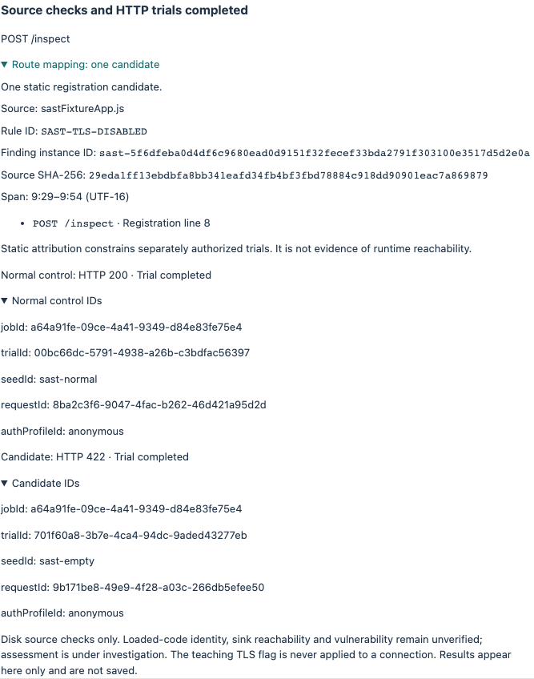

# Inspect individual SAST findings and route attribution

[日本語](SAST-MAPPING.ja.md) · [Basic hands-on](README.md)

This feature is on the development branch for 3.0.0. It is not included in the published 2.0.0 installers.
Use the source edition with `npm install` and `npm start`.

## 1. Analyze the teaching source

Open **Static Analysis**, enter the absolute path to `training/sast/routes` in this checkout, and run analysis.
These files are read-only teaching inputs. Do not launch them with Node or deploy them to a server.

Three `SAST-DANGEROUS-EVAL` findings appear. They share a rule ID but have separate finding instance IDs.
Expand **Route mapping** to inspect source SHA-256, line/column span and static candidates.



## 2. Compare unique, ambiguous and unavailable mappings

| File | Display | Meaning |
|---|---|---|
| `mapped.js` | One candidate | A direct local helper call is attributed to `POST /api/calculate` |
| `ambiguous.js` | Ambiguous | Shared code is registered for `POST /first` and `POST /second` |
| `dynamic.js` | Unavailable | An environment-dependent path is not guessed |

One candidate means one supported registration in the same file. It does not establish runtime reachability, reproduce a vulnerability or grant permission to test a target. Static analysis itself does not send HTTP requests.

## 3. Track findings in reports



JSON, HTML, Markdown and SARIF reports retain the instance ID, source hash and mapping metadata. SARIF preserves the original `ruleId`; instance IDs are added as `partialFingerprints`.
Identical file bytes, relative path and match position produce the same ID. Editing the source changes the ID. Do not reuse an old result as evidence for modified source.
Lines/columns are one-based; offsets and columns use UTF-16; the end of a span is exclusive.

## 4. Check source and scope with a dedicated executable sample

In **Static Analysis**, click **Run source/scope sample**. No source path or terminal is needed for this operation. It starts only the shipped sample on a temporary numeric loopback port; it never runs the source entered in the field above. **Cancel** stops the owned run. Your input and previous SAST results stay intact.

The sample's compiled JavaScript contains an unused `rejectUnauthorized: false` object. SAST detects the pattern, but the flag is never applied to a TLS connection. This is a source-binding exercise, not an intentional TLS vulnerability.



Expected results: normal control **HTTP 200**, candidate **HTTP 422**, both assessments **under investigation**. Expand Route mapping and each trial's IDs. They belong to one finding and job, with separate trial, seed and request IDs. The anonymous profile is explicit.

Before each setup/target send and after each successful response, the runner rereads the bounded source and checks its rule, span, hash, instance ID and route against a separately authorized scope. Changed or unavailable source blocks further sends and invalidates the result. Ambiguous, unsupported and parameterized candidates cannot create a bound runner. These checks do not prove that the running process loaded the same bytes or reached the flagged code.

Results stay on this screen and are not automatically saved. In the source edition, the equivalent command emits JSON to stdout:

```sh
npm run verifier:run -- --sast-sample
```

This dedicated option cannot be combined with campaign options or arbitrary URL/source arguments. Existing baseline/changed/fixed campaign commands and their private JSON/HTML reports are unchanged.

## Coverage and remaining work

Supported inputs are `.js`, `.cjs` and `.mjs` with top-level Express creation, literal route/mount paths, and local handlers, middleware and directly called helper functions. Parameterized paths are displayed as templates.
Imported routers/handlers, factories, dynamic/conditional/computed/chained registrations and analysis limits do not yield a unique conclusion. Existing SAST findings in TypeScript and other languages remain visible, with route mapping marked unsupported.

The dedicated sample and backend adapter now bind a finding to an authorized exact route. Selecting arbitrary applications in the GUI, attesting loaded source, correlating per-trial ZAP evidence and validating the 3.0.0 installers remain incomplete.
