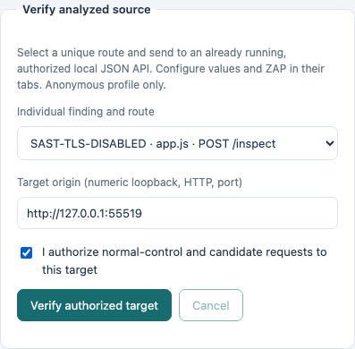
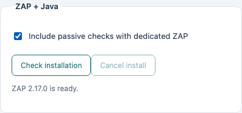
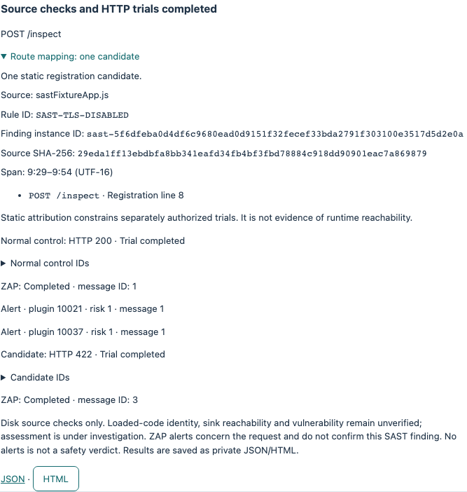

# SAST findings, local verification and ZAP evidence

[日本語](SAST-MAPPING.ja.md) · [Basic hands-on](README.md)

Available in Web Security Hub 3.0.0. Open **Static Analysis**. Its five control tabs separate source analysis, the shipped sample, an authorized target, input values and the optional ZAP environment. Help opens here without clearing your inputs or results.

## 1. Compare individual findings

In the source tab, analyze the absolute path to `training/sast/routes` in a source checkout. These three files are inert teaching inputs: do not execute or deploy them. Static analysis does not send HTTP requests.


| File | Mapping | Interpretation |
|---|---|---|
| mapped.js | One candidate | Local helper attributed to POST /api/calculate |
| ambiguous.js | Ambiguous | Shared code registered for POST /first and POST /second |
| dynamic.js | Unavailable | Environment-dependent route is not guessed |

Expand Route mapping. The rule ID remains compatible with earlier reports; the individual finding ID hashes the file bytes, relative path and match span. Edited source gets a new ID. SHA-256, one-based lines/columns and UTF-16 offsets identify the snapshot; span ends are exclusive. JSON/HTML/Markdown/SARIF retain metadata; SARIF adds individual partial fingerprints.


A unique static route does not grant execution permission or prove reachability. Supported mapping is file-local JavaScript (.js/.cjs/.mjs), literal Express registrations/mounts, local middleware/handlers and direct helper calls. Imported handlers, factories, conditional/computed/chained registrations and analysis limits remain unavailable or ambiguous. Other-language findings remain visible without supported route attribution.

## 2. Run the shipped source/scope sample

Select the sample tab and run it. No terminal or path is needed. Only the trusted, shipped app starts on a temporary loopback port. Entered source is never loaded as a program. Cancel stops the owned run; previous source inputs and static results remain.


Expect normal HTTP **200** and candidate **422**, both **under investigation**. The unused `rejectUnauthorized: false` object triggers a SAST rule but is never applied to a TLS connection. This exercises source binding; HTTP results do not establish a TLS vulnerability.

Before sending and after receiving, the runner rereads bounded source and rechecks rule/span/digest/instance/route against a separately authorized scope. It checks again after waiting for passive analysis. Changed or unavailable source invalidates evidence and prevents further requests. These checks do not attest which bytes a running process loaded or whether the flagged sink executed.

## 3. Verify an authorized local JSON API

Start your own test app separately. Analyze its source, then choose a supported finding in the target tab. Only a single, literal, unencoded ASCII GET/POST path is executable; parameter templates and ambiguous mappings cannot run. Use a numeric loopback HTTP origin with an explicit nondefault port, for example `http://127.0.0.1:4300`. Remote hosts, HTTPS and arbitrary authentication profiles are outside this feature.

In the values tab, enter JSON objects for normal and candidate values, a positive 2xx normal status, and at least one expected normal JSON field. GET encodes scalar values in the query; POST sends JSON. For the shipped example the values are `{"label":"normal"}`, `{"label":""}` and expected `{"accepted":true}` with status 200. Use values appropriate to your API.



Authorize this target explicitly and run. Changing the source selection, finding or origin clears authorization. The normal control runs first; failed normal control skips the candidate. The profile is anonymous with no stored cookies, no redirect following and no retries. The anonymous response stream is capped at 64 KiB. Source files are bounded to 1 MiB and static analysis has bounded traversal limits.


## 4. Optionally install and enable ZAP

In the ZAP tab, install the optional environment. It downloads approximately 330 MB from the official ZAP/Temurin releases and validates pinned sizes/SHA-256 before extraction. ZAP 2.17.0 and Temurin JRE 17.0.20.1+1 are stored in private application data, separately from the app bundle. Java heap is limited to 512 MiB. Internet access is needed for initial installation; the installed engine can verify local targets offline. Cancellation removes partial staging. Check installation validates the local receipt/files and permits repair. Vendor notices are retained.



Enable the checkbox and run the sample or authorized target. Each run owns a fresh process, private home and session; it does not adopt or clear a shared ZAP daemon. Passive analysis only: no spider or active scan. The runner waits for the queue with a 15-second bound and fails closed on cancellation, limits, unavailable or incomplete evidence. API reads are authenticated and loopback-only. Normal shutdown and the parent-death guardian clean up owned processes/session data.



Expand each trial to inspect job/trial/seed/request/profile IDs, ZAP session/message IDs and redacted alert fingerprints/plugin IDs/ranks. All five IDs plus method and exact URL must match one proxied message. A warning on the normal request does not transfer to the candidate even at the same URL. Duplicate alerts are coalesced. No raw request/response bodies, cookies, API keys or absolute source roots enter reports. The sample's passive header warnings are separate from its unused TLS flag. **Passive warnings do not confirm a SAST finding; zero warnings do not prove safety.** Disabled and incomplete states are explicit.

## 5. Save and inspect results

Each completed API operation saves private JSON and escaped, script-free bilingual HTML under application data `artifacts/private/source-verifier/<report-id>/`. JSON downloads and an inline HTML reader are available in the execution result. Access is tied to the current app session; reports on disk remain after restart. Preserve private files yourself when needed. Static-analysis reports are separate.

Input payload values are deliberately omitted from saved source reports. To reproduce your own trial, keep the source snapshot and a private source-plan JSON with the exact inputs. Do not commit credentials, local plans or private reports. Source results always remain **under investigation** without runtime instrumentation and an independent business oracle.

Source edition commands:

```sh
npm run verifier:run -- --sast-sample
npm run verifier:run -- --zap-install
npm run verifier:run -- --zap-status
npm run verifier:run -- --sast-sample --zap
npm run verifier:run -- --source-plan /absolute/private/plan.json
```

A source plan contains `sourceDir`, current `finding` metadata (ruleId, findingInstanceId, sourceDigest, relativePath, sourceSpan, routeMapping), `origin`, `normalValues`, `candidateValues`, `expectedJson`, `expectedStatus`, `authorized: true` and `useZap`. It uses the same strict contract and scope checks as the GUI. Flags cannot be mixed with campaign options. CLI prints JSON and private saved paths; cancellation exits 130. Existing baseline/changed/fixed campaigns remain available.

Optional engines: [ZAP](https://www.zaproxy.org/download/) (Apache-2.0), [Temurin](https://adoptium.net/temurin/) (GPLv2 with Classpath Exception). The desktop installer excludes source-only Appium/WebdriverIO automation dependencies. The source tree still has extract-zip advisories through that optional automation chain; see [security](../../SECURITY.md).
